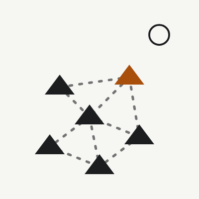

<div align="center">
  
  <h1>paros</h1>
  <p><strong>Paxos, in Rust.</strong> A learning implementation of the Paxos family of
  consensus algorithms, built and validated with deterministic simulation testing.</p>
</div>

> ⚠️ A learning project, work in progress. Not intended for production use.

## The name

`paros` is named after [Paros](https://en.wikipedia.org/wiki/Paros), my favorite Greek
island, and winks at [Paxos](https://en.wikipedia.org/wiki/Paxos), the (other) Greek island
Leslie Lamport set [the consensus algorithm](https://en.wikipedia.org/wiki/Paxos_(computer_science))
on. Two islands, one parliament.

## What it is

The design is **sans-IO**: [`paros-core`](crates/lib/paros-core) is a pure synchronous state machine
(`step` / `tick` in, one `Ready` out, an `advance()` handshake) with no I/O, no clock, and no
randomness. An async driver built on [moonpool](https://github.com/PierreZ/moonpool) wraps it
and performs all side effects, honoring the persist-before-send rule at the heart of Paxos
safety.

The same code runs in production and in **deterministic simulation**: every seed replays
bit-for-bit, network chaos is injected, and an audit asserts on every transition that no two
acceptors ever choose different values.

👉 **[Read the site](https://pierrez.github.io/paros/)**

## At a glance

The workspace holds three products, each in its own directory of `crates/` (#722 (three
products)):

| Product | Crates |
|---------|--------|
| The library, `crates/lib/` | [`paros-core`](crates/lib/paros-core), the sans-IO Multi-Paxos state machine (std-only, wasm-safe, zero deps with `default-features = false`); one crate per layer above it (wire, model, tunables, storage, net, client, observe, roles, coordinator, machine); and [`paros`](crates/lib/paros), the facade a program depends on |
| The binaries, `crates/bin/` | [`parosd`](crates/bin/parosd), one uniform daemon per machine; [`parosctl`](crates/bin/parosctl), the CLI; [`paros-bench`](crates/bin/paros-bench), the load generator |
| The harness, `crates/sim/` | [`paros-sim`](crates/sim/paros-sim), the deterministic-simulation harness (the workload, the fault world, the audit), and its runners |

## Run it

A cell of five machines with Docker alone, from a fresh clone:

```sh
docker compose up -d --build
docker compose run --rm init
docker compose run --rm parosctl tenant create acme
docker compose run --rm parosctl journal create acme orders   # prints journal=T/J
docker compose run --rm parosctl write T/J hello world --leader 7
docker compose run --rm parosctl read T/J
```

Every session can run over TLS, mutual by default: `parosctl tls init` writes the
authority and every certificate in one step.

A journal's durability can change while it runs: `parosctl configure --tenant acme --journal
orders --survive machines=2` asks for five acceptors, and the tenant coordinator moves
the journal there by reconfiguration, without losing a write (#214 (tenant modes)).

A multi-writer journal can put many writers' writes in one slot through batchers (#145
(batchers)): `parosctl configure --tenant acme --journal orders --batchers 3` books three on the
cell's `stateless` machines, `parosctl resolve acme` names them, and each writer gets its own
positions back. `--proxies N` and `--replicas N` are the journal's other scale counts (#753
(per-journal proxies)): 0 runs the job in the leader's process.

Every `parosd` is also a frontend (#723 (frontend as a parosd role)): it checks a Biscuit token,
resolves `paros://<tenant>/<journal>` and forwards the call. `parosctl configure --tenant acme
--frontend-count 2` books two on the cell's `stateless` machines, and `parosctl resolve acme` names
them.

A universe can hold more than one cell: `parosctl init --idle` forms a cell with no universe,
`parosctl universe add-cell` joins it, and `parosctl tenant create --cell` puts a tenant in it.
A tenant created without `--cell` goes to the cell its bucket names (#713 (bucket placement)):
`CRC16(name) mod 16384`, as Redis Cluster does. The first cell holds every bucket, and
`parosctl universe buckets assign 8192-16383 cell-2` gives a range to another cell.
`--cell-selector env:prod` picks the cell by its tags (#672 (cell tag selector)), and
`parosctl universe status` shows the buckets and tenants of each cell.
Any machine resolves a tenant to its cell. Every `parosd` is also a resolver (#233 (resolver)):
with a token, `parosctl --token … resolve acme` asks a resolver first, which checks the token and
sends the client to the tenant's cell, from the universe directory it read last.
`parosctl universe remove-cell` removes an empty cell for good.

Each tenant scrubs its journals in the background: its coordinator reads every acceptor's copy
of every record again, and an acceptor writes a damaged record again from its own copy
(#362 (background scrubbing)). `parosctl status --tenant acme` shows the pass and what it found.

A full disk is a normal result, never a crash or a lost write: the store goes read-only (it
still votes in Phase 1 and serves reads) and tries again later, placement passes over a machine
low on space, and a leader whose acceptors fall behind answers writes `busy` until they catch up
(#360 (disk full)).

Each machine serves Prometheus metrics and two probes (`/metrics`, `/healthz`, `/readyz`) when
`PAROS_HTTP_LISTEN` is set. It pushes its spans and metrics to an OpenTelemetry collector when
`PAROS_OTLP_ENDPOINT` is set. To measure throughput and latency on one machine, with no cell to
start first:

```sh
paros-bench --local 3 --duration 30s
```

The copy-paste demo, with Docker Compose or three local processes, is
[`DEMO.md`](DEMO.md). The walkthrough — init, write and read, kill and restart a
machine, supersede a writer, lose a disk — is
[`crates/bin/parosd/README.md`](crates/bin/parosd/README.md).

Roadmap (filed as GitHub issues): **M1** safety kernel, **M2** Multi-Paxos, **M3**
storage-fault tolerance, **M4** online reconfiguration, **M5** scale-out and hardening.

## Learning Paxos with paros-core

The composable roles of [`paros-core`](crates/lib/paros-core) (`Proposer`, `Acceptor`,
`Replica`, `Matchmaker`, `ProxyLeader`, `ReplicaNode`) can be driven by hand. The interactive
Paxos game on the site does exactly that: you are the network and the clock, each level runs the
real `paros-core` compiled to WebAssembly, and each level teaches one property. Five acts, in
order: a single decree; a replicated log; truncation and reads; flexible quorums, grids, quorum
reads, the handoff and the matchmakers; proxy leaders and the replica tier. The engine is
[`paros-wasm`](crates/support/paros-wasm) (feature `paxos`), and its tests replay a reference
solution of every level (`cargo nextest run -p paros-wasm`).

## Build and test

Enter the Nix dev shell (`nix develop`, or rely on direnv), then:

```sh
cargo build
cargo nextest run                  # or: cargo test
cargo fmt && cargo clippy -- -D warnings
cargo xtask sim run paros-chain             # coverage-guided (sancov) simulation sweep, the CI gate
cargo run --bin sim-paros-hunt -- main 2000 # raw seed hunt; a failing seed is its deliverable
cargo run --bin sim-paros-hunt -- canary 500 # every seed twice under moonpool's determinism canary; a diverging replay is its deliverable
```

## License

Licensed under the [Apache License, Version 2.0](LICENSE).
