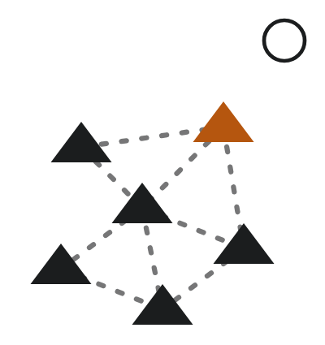

<div align="center">
  <picture>
    <source media="(prefers-color-scheme: dark)" srcset="docs/assets/paros-logo-dark.png" />
    <source media="(prefers-color-scheme: light)" srcset="docs/assets/paros-logo-light.png" />
    
  </picture>
  <h1>paros</h1>
  <p><strong>Paxos, in Rust.</strong> A learning implementation of the Paxos family of
  consensus algorithms, built from the ground up, one proved flavor at a time.</p>
</div>

> ⚠️ A learning project, work in progress. Not intended for production use.

## The name

`paros` is named after [Paros](https://en.wikipedia.org/wiki/Paros), my favorite Greek
island, and winks at [Paxos](https://en.wikipedia.org/wiki/Paxos), the (other) Greek island
Leslie Lamport set [the consensus algorithm](https://en.wikipedia.org/wiki/Paxos_(computer_science))
on. Two islands, one parliament.

## What it is

The design is **sans-IO**: [`paros-consensus`](crates/lib/paros-consensus) is a pure synchronous state machine
(`step` / `tick` in, one `Ready` out, an `advance()` handshake) with no I/O, no clock, and no
randomness. A driver owns it and performs all side effects, honoring the persist-before-send
rule at the heart of Paxos safety.

Today the repository holds the consensus core and its proofs: the core and its tests, the
[`paros`](crates/lib/paros) facade, the TLA+ models of [`specs/tla/`](specs/tla), and the Paxos pages of the
site. The next step is a TLA+ model for every Paxos flavor the core builds, then a journal
designed again on top of it. [`docs/architecture/`](docs/architecture) is the target design.

The journal service that came before (`parosd`, `parosctl`, `paros-bench`, the library layers
and the `paros-sim` simulation) is at the git tag
[`v0.2.0-alpha.1`](https://github.com/PierreZ/paros/tree/v0.2.0-alpha.1).
[`docs/archive/v0.2.0-alpha.1/`](docs/archive/v0.2.0-alpha.1) has one recap per removed crate.

👉 **[Read the site](https://pierrez.github.io/paros/)**

## At a glance

| Path | What it is |
|------|------------|
| [`crates/lib/paros-consensus`](crates/lib/paros-consensus) | the sans-IO Paxos roles (proposer, acceptor, replica, matchmaker, proxy leader, quorum reads) and `ColocatedNode`; std-only, wasm-safe, zero deps with `default-features = false` |
| [`crates/lib/paros`](crates/lib/paros) | the facade a program depends on |
| [`crates/support/paros-wasm`](crates/support/paros-wasm) | the engine of the step-through diagrams of the site's Paxos pages |
| [`specs/tla`](specs/tla) | TLA+ models of the protocol rules, checked with TLC |
| [`website`](website) | the site |
| [`docs`](docs) | the target design, the Paxos knowledge base, design notes and paper references |

## Learning Paxos with paros-consensus

To use the crate, start with its [README](crates/lib/paros-consensus/README.md) and with
[`quickstart.rs`](crates/lib/paros-consensus/examples/quickstart.rs): three nodes, the driver loop, a
crash and a restart.

Eleven small, deterministic, runnable examples are in
[`paros-consensus`](crates/lib/paros-consensus). The first seven teach the algorithm: they drive the
composable roles (`Proposer`, `Acceptor`, `Replica`, `Matchmaker`) by hand or step
`ColocatedNode` message by message, with a printed trace and assertions for the property each
one teaches. Read them in order:

1. [`single_decree.rs`](crates/lib/paros-consensus/examples/single_decree.rs) — Phase 1, P2c, Phase 2:
   one value, and why a higher ballot must adopt a value it finds accepted.
2. [`multi_paxos.rs`](crates/lib/paros-consensus/examples/multi_paxos.rs) — slots versus ballots, one
   Phase 1 amortized over many slots, and leader recovery as P2c applied slot by slot.
3. [`matchmaker.rs`](crates/lib/paros-consensus/examples/matchmaker.rs) — configuration discovery
   through the matchmakers, a reconfiguration as a round change, and the matchmaker set
   itself chosen by the same single-decree Paxos over `Vec<MatchmakerId>`.
4. [`acceptor_grid.rs`](crates/lib/paros-consensus/examples/acceptor_grid.rs) — the acceptor grid of
   Compartmentalized Paxos: six nodes under `QuorumSystem::grid(2, 3)`, every slot's Phase 2
   addressed to one column so each acceptor sees a third of the commands, a majority of
   promises that still misses a column, and the next election needing one acceptor of every
   column (a full row is one) because each promise in it reports exactly its own column's value.
5. [`quorum_read.rs`](crates/lib/paros-consensus/examples/quorum_read.rs) — Paxos Quorum Reads: a
   row of the same grid answers with its vote watermarks while a column is mid-decision, the
   reader settles on the maximum and waits for its replica to apply it, and the leader sends
   no beat and opens no round — a linearizable read with no leader and no clock.
6. [`proxy_leader.rs`](crates/lib/paros-consensus/examples/proxy_leader.rs) — proxy leaders: the leader
   sequences and a `ProxyLeader` on another process fans each slot's `Accept` out, folds the
   votes and announces the `Commit`; a dead proxy's round is taken back, and a handoff
   successor re-delegates what it inherited.
7. [`replica_tier.rs`](crates/lib/paros-consensus/examples/replica_tier.rs) — the replica tier: three
   acceptors vote and keep the chosen prefix, two `ReplicaNode`s learn it and never vote, a replica that lost a `Commit` catches up from the
   leader's beat, and each slot's reply is owned by one replica (`slot % replica_count`).

The four others drive `ColocatedNode` as a driver does, with one disk for each node and a toy
network ([`examples/common/cluster.rs`](crates/lib/paros-consensus/examples/common/cluster.rs)):

8. [`quickstart.rs`](crates/lib/paros-consensus/examples/quickstart.rs) — the driver loop (persist,
   then send, then learn), an election, writes, a follower that crashes and catches up, and a
   new leader.
9. [`journal_calls.rs`](crates/lib/paros-consensus/examples/journal_calls.rs) — the journal that the
   log carries: `SetLeader`, `Write`, a retry, a fenced writer, a read, `Truncate`, and the
   `Outcome` of each one.
10. [`leader_handoff.rs`](crates/lib/paros-consensus/examples/leader_handoff.rs) — the leader hands
    its ballot to a successor with no election, the one-hop rule, and a lost handoff that an
    ordinary election repairs.
11. [`reconfiguration.rs`](crates/lib/paros-consensus/examples/reconfiguration.rs) — five nodes and
    three matchmakers: `{1, 2, 3}` becomes `{1, 4, 5}`, the matchmakers forget the old
    configuration, and a removed node retires.

```sh
cargo run -p paros-consensus --example single_decree
cargo run -p paros-consensus --example multi_paxos
cargo run -p paros-consensus --example matchmaker
cargo run -p paros-consensus --example acceptor_grid
cargo run -p paros-consensus --example quorum_read
cargo run -p paros-consensus --example proxy_leader
cargo run -p paros-consensus --example replica_tier
cargo run -p paros-consensus --example quickstart
cargo run -p paros-consensus --example journal_calls
cargo run -p paros-consensus --example leader_handoff
cargo run -p paros-consensus --example reconfiguration
```

## Build and test

Enter the Nix dev shell (`nix develop`, or rely on direnv), then:

```sh
cargo build
cargo nextest run                  # or: cargo test
cargo fmt && cargo clippy --all-targets -- -D warnings
nix develop .#tla --command scripts/check-tla.sh   # TLC on the TLA+ models
```

## License

Licensed under the [Apache License, Version 2.0](LICENSE).
