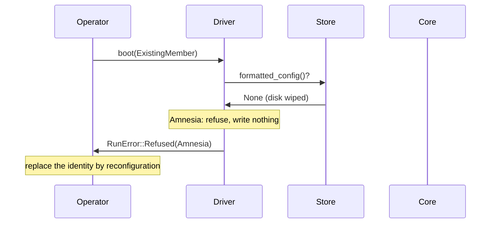

# Boot safety: the format marker, and a wiped node never rejoins

Group: Storage. Status: verified 2026-10-31.

An acceptor's promise is a statement about its own future that no other node holds. A node that
lost its disk and boots empty would answer a Phase 1 with "nothing accepted" for slots it once
voted on: it **reneges** on its promises ([PML §5.1]). An empty disk looks exactly like a first
boot, so paros does not guess. The operator states what it boots (`BootKind`), the store carries
a durable **format marker**, and the library refuses a boot where the two disagree. A wiped node
**never rejoins**: the acceptor set heals around it by reconfiguration, and a wiped matchmaker is
replaced by a handover.

## 1. Problem

- [PML §5.1]: an inaccessible file is indistinguishable from a fresh empty disk. Chubby leaves a
  marker in GFS at first start-up; an empty disk with an existing marker means corruption.
- [PML §5.1] then rebuilds the replica as a **non-voting** member until it sees one full Paxos
  instance start. [PAR §2.3] shows that this "MarkNonVoting" can still violate safety: lost
  promises let an old leader overwrite a committed entry.
- A node that restarts under an edited configuration (another membership, another quorum
  system) would count quorums its peers do not.

## 2. Model

- A crash keeps the disk; a **wipe** loses it whole. A wipe is not a corrupted record: CTRL
  needs the record's identity, and a wiped disk has none ([corrupted storage
  recovery](corrupted-storage-recovery.md)).
- The operator's claim is external input: a refusal is a result, never a panic.

## 3. Roles and state

| Role | State | Durable? |
|---|---|---|
| Operator | the claim: `BootKind::FirstBoot` or `BootKind::ExistingMember` | no: configuration data |
| Store (journal or matchmaker registry) | the format marker and the `Config` it was written under (#147, #183, #207) | yes, in the metainfo, before the first promise |
| Machine (`parosd`) | its `node_id`, random, minted at format (#225) | yes, in the machine record |

## 4. Normal flow

1. **First boot.** The driver formats the store (writes the marker and the `Config`) and syncs it
   **before the core reads a byte**. The marker lands no later than the first promise (a matchmaker's: the first
   registration), which is
   the ordering every refusal relies on (`check_format_marker`).
2. **A restart.** The operator claims `ExistingMember`; the marker is there and names the same
   recorded `Config`; the boot scan loads the store and the core rebuilds from it.
3. **The checks** (`check_format_marker`, in `paros-roles` `node/boot.rs` and `matchmaker.rs`):

| Claim | Store | Result |
|---|---|---|
| `FirstBoot` | no marker | format, sync, boot |
| `ExistingMember` | marker, same `Config` | boot |
| `ExistingMember` | no marker | `BootRefusal::Amnesia` |
| `FirstBoot` | marker | `BootRefusal::AlreadyFormatted` |
| `ExistingMember` | marker, another `Config` | `BootRefusal::ConfigMismatch` |

A refused boot writes nothing and sends nothing (`RunError::Refused`).

## 5. Recovery flow

- **An amnesiac acceptor.** It stays down for good. The cell removes it by reconfiguration, and a
  new identity joins as a spare that heals by catch-up and `TrimmedTo`
  ([reconfiguration](reconfiguration.md)). A trim-point jump restores the floor, never the
  promise ([truncation](truncation.md)).
- **An amnesiac matchmaker.** It is replaced through a matchmaker-set handover, never rejoined
  ([matchmaker generations](matchmaker-generations.md)).
- **A wiped `parosd`.** Its `node_id` is minted at format, so a wiped disk is a new machine: "a
  wiped identity never rejoins" holds by construction. A disk with stores and no machine record
  is refused as amnesia (`paros-machine/src/lifecycle.rs`).
- **A configuration mismatch.** The operator restores the configuration the store was formatted
  with, and changes the membership by reconfiguration. Nothing was written, so the node comes back
  as the member it was.

## 6. Why it is safe

- **The promise survives or the node stays out.** A booted acceptor either holds every promise it
  ever made (its store carries the marker, and the marker landed before the first promise), or it
  is refused. A wiped node never answers a Phase 1, so it can never renege.
- **Rejoining as non-voting is not enough.** [PAR §2.3] shows MarkNonVoting violating safety.
  paros does not try to make a wiped identity safe again; it retires the identity.
- **The configuration is a safety input.** The membership and the quorum system are read once, at
  construction. A restart under another one is refused, so a node never counts quorums its peers
  do not (#207). The bootstrap counts are not recorded (#754), so a restart may name other counts.
- **The matchmaker rule is load-bearing.** With the `Amnesia` arm removed, a 3,000-seed hunt went
  red on 4 seeds ("matchmaker: a restart recovers every durable registration", "a recovered gc
  watermark never regresses"; witness 5299901180798451264 on that build), and green with it (the
  `check_format_marker` doc in `paros-roles/src/matchmaker.rs`).

## 7. Liveness

- A wiped acceptor costs one member until the reconfiguration lands; a configuration that keeps a
  Phase-1 quorum stays live meanwhile.
- A cell whose wipes left a journal without a Phase-1 quorum cannot heal that journal; the sim
  excuses it from convergence ("convergence: a journal its wipes left without a Phase-1 quorum is
  excused").

## 8. Costs

- One durable write and one sync at a first boot.
- A wiped node is a full replacement: a new identity and a reconfiguration, not a local repair.

## 9. In paros

| What | Where |
|---|---|
| The claim and the refusals | `paros-storage/src/boot.rs`: `BootKind`, `BootRefusal`, `RunError` |
| The node check | `paros-roles/src/node/boot.rs`: `check_format_marker` |
| The matchmaker check | `paros-roles/src/matchmaker.rs`: `check_format_marker` |
| The marker in the store | `paros-storage/src/journal.rs`: the metainfo (two local copies) |
| The machine identity | `paros-machine/src/lifecycle.rs` (the machine record); `docs/architecture/03-2-machines.md` |

**Sim gates and oracles** (`paros-sim/src/process/node.rs` unless named):

- `"storage: an amnesia refusal names a wiped identity"`: only a wiped disk is ever amnesiac.
- `"storage: a first boot never meets a formatted store"`, `"storage: a configuration refusal
  names an operator's edit"`, `"storage: a restarted node's disk is wiped and the identity
  retired"`.
- `"generation: a matchmaker's registry is lost for good"` (`audit/matchmaker.rs`).
- Machine wipes roll (moonpool #344 (rolling wipes)): one unhealed wipe at a time, healed once the
  cell holds no booking on the old id (`paros_sim::machine::heal`); a founder's old id never heals.

**Divergences from the sources:**

- [PML §5.1] rebuilds a corrupted replica as non-voting. paros never rejoins a wiped identity.
- [PML §5.1] keeps the marker in GFS, outside the node. paros keeps it on the node's own store
  and takes the operator's claim as the other half of the evidence.

## 10. Pitfalls

- **An empty store taken as a first boot.** `ColocatedNode::new` cannot tell an empty-but-openable
  store from a first boot, so the refusal must happen in the driver, on the claim (the
  `node/boot.rs` doc).
- **A false amnesia refusal.** A marker read after a failed format sync was staged, not durable; a
  power loss dropped it, and the restart was refused as amnesia with no wipe. The store is now
  settled (every file and directory synced) before its marker is trusted (#348, commit
  `de21925`).
- **An edited configuration file.** A node that switched from a majority to a flexible split, or to
  a membership missing a peer, would count quorums its peers do not (#207).

## 11. Relatives

- [Corrupted storage recovery](corrupted-storage-recovery.md): a damaged record, not a lost disk.
- [Truncation and the trim-point jump](truncation.md): the jump that restores a floor, never a
  promise.
- [Reconfiguration as a round change](reconfiguration.md): how the acceptor set heals around a
  wiped node.
- [Persist before send](persist-before-send.md): the marker lands before the first promise or
  registration.

## 12. Sources

- [PML] Chandra, Griesemer, Redstone, *Paxos Made Live*:
  `docs/references/papers/paxos-made-live/transcript.md` §5.1 (disk corruption, the GFS marker).
- [PAR] Alagappan et al., *Protocol-Aware Recovery for Consensus-Based Distributed Storage*:
  `docs/references/papers/protocol-aware-recovery/transcript.md` §2.3 (MarkNonVoting).

[PML]: ../../references/papers/paxos-made-live/transcript.md
[PML §5.1]: ../../references/papers/paxos-made-live/transcript.md
[PAR]: ../../references/papers/protocol-aware-recovery/transcript.md
[PAR §2.3]: ../../references/papers/protocol-aware-recovery/transcript.md
