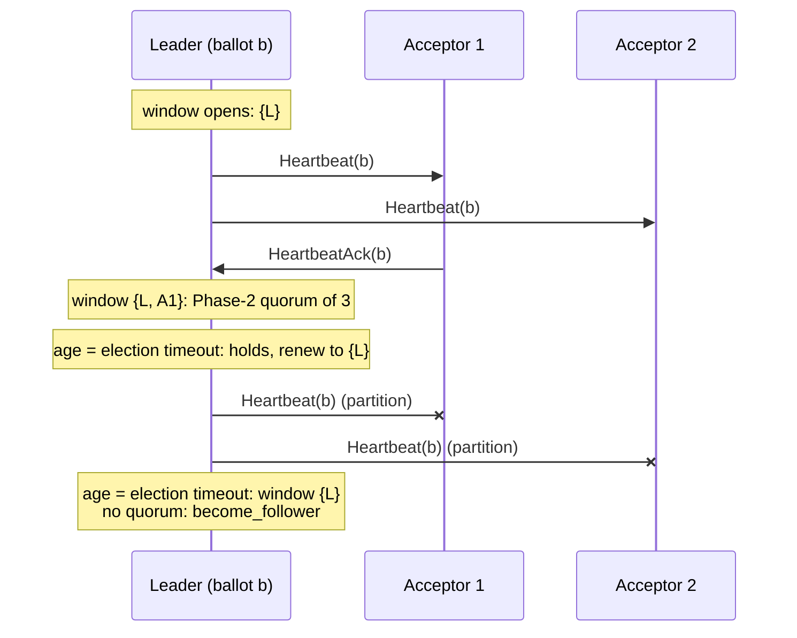

# Leadership fence and CheckQuorum

Group: Leader. Status: verified 2026-10-31.

A paros leader holds a **standing authority** beside its Phase-2 rounds: a **fence** (the
highest slot a predecessor could have acked) and a **CheckQuorum window** (the acceptors that
acked at the leader's ballot in the current election timeout). A leader that cannot fill the
window with a Phase-2 quorum of its configuration steps down.

## 1. Problem

A Paxos leader keeps its ballot until something tells it that a higher ballot exists: a
`Nack`, a higher `Prepare`, a higher beat. A leader that is cut off from its quorum gets none
of these. If it is also idle, it sends no `Accept` that could be refused. It stays leader for
ever, keeps taking proposals, and answers clients for a log suffix that the rest of the cell
has already replaced (#95, the "zombie leader").

This is not a safety bug in Paxos: the zombie's `Accept`s cannot reach a quorum. It is a
liveness and correctness-at-the-edge bug: the driver above the core trusts the role, and in
paros it fed the double-apply of #94. [PML §5.2] has the same concern from the read side: a
master that is not master can serve stale reads, so Chubby uses leases. [PMMC §3] has it from
the liveness side: a leader monitors its competitor and escalates only when the competitor
stops answering.

## 2. Model

- The same crash-recovery, asynchronous model as the election card.
- The check is on the leader's own tick clock, not on a wall clock. It needs no bound on
  clock drift, because it gives no promise to anybody: it only makes the leader **give up**
  sooner. Safety never rests on it.
- The window length is the node's current randomized election timeout (`election_timeout`,
  drawn in `[T, 2T)` by the driver).

## 3. Roles and state

| Role | State | Durable? |
|---|---|---|
| Leader | `Authority.fence`: `next_slot - 1` at the win or at the install | no, volatile |
| Leader | `Authority.quorum_acked_by`: the acceptors (and self) that acked at the leader's ballot in this window | no, volatile |
| Leader | `Authority.quorum_elapsed`: ticks since the window last closed with a quorum | no, volatile |
| Follower | nothing new: it answers each `Heartbeat` with a `HeartbeatAck` at the beat's ballot | n/a |

All of it lives in `Authority` (`paros-core/src/proposer/authority.rs`), which the `Proposer`
embeds. It dies whole with the leadership (`Authority::clear`, through `Proposer::abandon`).

## 4. Normal flow

1. At the win (`try_become_leader`) or at a handoff install (`on_relinquish`), the node calls
   `Proposer::open_authority(fence, own_vote)`. The window starts with the leader's own vote
   if it is a member of its configuration.
2. Each tick, a leader broadcasts a `Heartbeat` (`ColocatedNode::tick`) and then runs
   `tick_check_quorum`.
3. A member's `HeartbeatAck` at the leader's ballot credits the window (`on_heartbeat_ack`,
   `node/replication.rs`). A member's `Accepted` at the leader's ballot on a colocated round
   credits it too (`on_accepted`, `node/phase2.rs`), so a busy leader does not depend on beats.
4. When the window's age reaches the election timeout, `tick_check_quorum` asks
   `authority_holds(&self.acceptors)`. If a Phase-2 quorum acked, the window renews. If not,
   the node counts `quorum_lost_step_downs` and calls `become_follower(None)`.

## 5. Recovery flow

- **The leader steps down.** It becomes a follower with no leader hint. It keeps its promise
  and its records. Its next campaign, if any, is at a strictly higher round.
- **The partition heals.** The old leader hears a beat at a higher ballot, or a `Prepare`, and
  follows. Nothing it did during the partition was chosen, because no quorum accepted it.
- **The window fails on a healthy cell** (a slow tick, lost acks). The cost is one election.
  The window length equals the election timeout, so by the time the leader steps down, its
  peers are already eligible to campaign (`tick_check_quorum` doc comment; etcd-raft
  `raft.go:224`).

## 6. Why it is safe

CheckQuorum only removes a leadership; it never grants one. So it cannot break Paxos safety.
The argument that matters is why the window asks for a **Phase-2** quorum and not a Phase-1
quorum (`Authority::holds`):

- The authority claims that **no later ballot has decided anything behind this leader**.
- A later ballot must win Phase 1 first. Every Phase-1 quorum intersects every Phase-2 quorum
  (`QuorumSystem::cross_intersects`, [Flexible Paxos]). So if a Phase-2 quorum acked at `b` in
  this window, every successor's Phase-1 quorum met an acceptor that still held `b` at that
  time.
- Under a majority system the two quorums are equal. Under a flexible or grid system the
  Phase-2 quorum is smaller, which is the weaker and correct requirement.

The **fence** is a separate claim: everything a previous leader could have acked sits at or
below `next_slot - 1`, because the promise quorum reported it (and an acceptor that truncated
the range `Nack`s instead of under-reporting). The GC campaign and the read basis read the
fence; a handoff leader that cannot cover its inherited fence resigns (see the handoff card).

## 7. Liveness

- A healthy leader refills the window every tick: every reachable member acks every beat.
- On a cell of two acceptors, losing one acceptor loses the quorum, so the leader steps down
  and no node can win. The cell waits for the second acceptor. The sim uses this regime with
  attrition to make the step-down happen (commit `db340a8`).
- paros has **no vote lease**. etcd-raft pairs CheckQuorum with a follower-side rule: a
  follower that heard a leader within the election timeout ignores a higher vote request
  ([etcd-raft §5], `raft.go:1101`). paros's acceptors promise any higher `Prepare`. A node that
  comes back from a partition can therefore depose a healthy leader once; the cost is one
  election, and the randomized timeouts keep it rare.

## 8. Costs

- No extra messages: the window reads the beats and `Accepted`s the leader already exchanges.
- One `BTreeSet` insert per ack and one quorum check per election timeout.
- The real cost is a false step-down: one election, roughly one election timeout plus one
  Phase 1.

## 9. In paros

| What | Where |
|---|---|
| The tally: fence, window, `open`, `renew`, `credit`, `tick`, `holds` | `paros-core/src/proposer/authority.rs`: `Authority` |
| The `Proposer` wrappers | same file: `open_authority`, `renew_authority`, `credit_authority`, `tick_authority`, `authority_holds`, `fence` |
| The policy: how long a window runs and that an empty one resigns | `paros-core/src/node/authority.rs`: `ColocatedNode::tick_check_quorum` |
| The credits | `node/replication.rs`: `on_heartbeat_ack`; `node/phase2.rs`: `on_accepted` |
| The call site | `paros-core/src/node.rs`: `ColocatedNode::tick`, leader branch |
| Where the fence opens | `node/election.rs`: `try_become_leader`; `node/handoff.rs`: `on_relinquish` |

The rule is stated in the doc comments of `tick_check_quorum` (why it exists, why the window
length) and of `Authority::holds` (why Phase 2).

**Sim gates and oracles** (`paros-sim/src/audit/state.rs`):

- `"a leader deposed by a promise-majority stops beating within an election timeout
  (CheckQuorum)"` (`assert_always!`): the budget is `2 × timeout + DEPOSED_TICK_SLACK` ticks
  of beats after a promise majority moves past the leader's ballot, or after its last ack at
  that ballot, whichever is later.
- `"a leader without an ack quorum steps down (CheckQuorum)"` (`assert_sometimes!`): some seed
  really makes the step-down happen.
- Unit tests: `a_leader_without_an_ack_quorum_steps_down_after_its_window` and
  `a_leader_hearing_acks_keeps_leadership_across_windows`
  (`paros-core/src/node/tests/replication.rs`).

**Divergences from the sources:**

- etcd-raft counts "recently active" voters against the voters' quorum
  (`ProgressTracker::QuorumActive`, `tracker/tracker.go:216`). paros counts acks at its own
  ballot against a **Phase-2** quorum of its configuration.
- etcd-raft makes CheckQuorum an option, required for lease reads (`raft.go:336`). paros always
  runs it and has no lease reads; every read is a leaderless quorum read.
- etcd-raft has the vote lease (§7); paros does not.
- [PML §5.2] master leases let the master serve local reads and make replicas refuse other
  proposers. paros takes neither half: no local reads, no refusal.
- A proxy leader's votes never reach the leader's tally, so a leader whose rounds all go
  through proxies keeps its authority on `HeartbeatAck` alone (`credit_authority` doc).

## 10. Pitfalls

- **The zombie leader (#95).** Before CheckQuorum, `tick` advanced the election clock only on
  non-leaders. The audit claim "a leader deposed by a promise-majority stops beating within an
  election timeout" went red on 23 of 2000 network-axis seeds (for example
  901969623722906706, a deposed leader still beating 55 ticks later). All 23 are green with the
  fix (commit `db340a8`).
- **A joining acceptor must not inflate the window (#122).** A beat reaches the whole pool, but
  `on_heartbeat_ack` drops an ack from a node outside the active configuration.
- **A stale ack must not count.** Only an ack that echoes the leader's current ballot credits
  the window; a fresh leadership starts a fresh window, so an earlier leadership's acks cannot
  fill it.
- **A delegated round's votes do not count.** The fold refuses them (`Rounds::fold_accepted_in`),
  so they never credit the window. Do not "fix" this by crediting proxy votes: the leader has
  not heard from those acceptors.
- **A leader outside its own configuration** has no own vote. `open_authority` and
  `renew_authority` take `own_vote` as an `Option` for this case (#122).

## 11. Relatives

- [Election, P2c merge and gap fill](election.md): the win that opens the authority and its
  fence.
- [Leader handoff](leader-handoff.md): an install opens a fresh window and an inherited fence,
  with a deadline to cover it.
- [Flexible quorums](flexible-quorums.md) and [grid quorums](grid-quorums.md): why the window
  asks for a Phase-2 quorum.
- [Leaderless quorum reads](leaderless-reads.md): why paros needs no lease.
- Configuration GC (planned): it counts chosen indices past the fence.

## 12. Sources

- [etcd-raft] `docs/references/etcd-raft/check-quorum.md` (commit `c51f010`): §2
  `tickHeartbeat` (`raft.go:861`), §3 `QuorumActive` (`tracker/tracker.go:216`), §4
  `MsgCheckQuorum` (`raft.go:1281`), §5 the vote lease (`raft.go:1101`).
- [Flexible Paxos] Howard, Malkhi, Spiegelman:
  `docs/references/papers/flexible-paxos/transcript.md` §3 and §5: Phase-1 and Phase-2 quorums need to
  intersect only each other.
- [PML] *Paxos Made Live*: `docs/references/papers/paxos-made-live/transcript.md` §5.2 (master
  leases, heartbeat, and the master-churn problem).
- [PMMC] *Paxos Made Moderately Complex*:
  `docs/references/papers/paxos-made-moderately-complex/transcript.md` §3 (monitor the
  competitor, escalate on silence), §4.4 (leases need bounded clock drift).
- [paxos-vs-raft] `docs/references/papers/paxos-vs-raft/transcript.md` §3 (a larger term makes a
  node step down; a smaller one gets a negative reply).
- FoundationDB, `docs/references/foundationdb/cluster-controller-election.md` §6: the leader
  keeps leadership only while a quorum answers its heartbeat and releases it after
  `POLLING_FREQUENCY` without one.

[PML §5.2]: ../../references/papers/paxos-made-live/transcript.md
[PMMC §3]: ../../references/papers/paxos-made-moderately-complex/transcript.md
[Flexible Paxos]: ../../references/papers/flexible-paxos/transcript.md
[etcd-raft §5]: ../../references/etcd-raft/check-quorum.md
