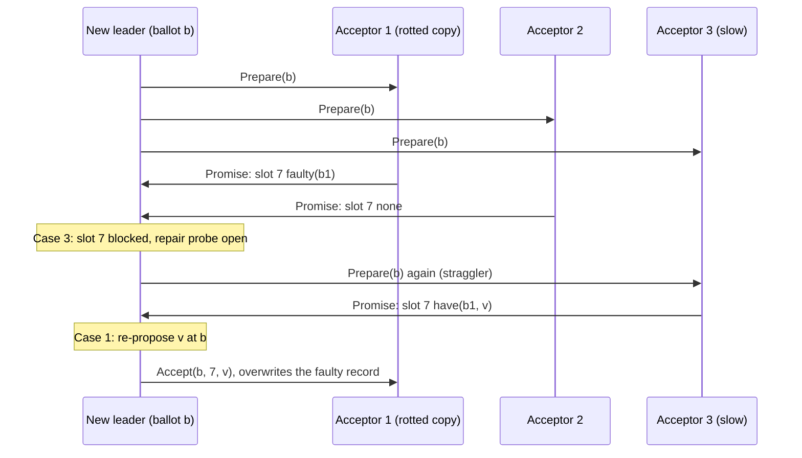

# Corrupted storage recovery

Group: Storage. Status: verified 2026-10-31.

Paxos assumes stable storage. A real disk breaks that: a block returns an error, or silently
returns other bytes ([PAR §2.1]). **Protocol-aware recovery** (CTRL) uses the copies other nodes
hold. The store detects a damaged record and reports its identity; the protocol then decides,
per slot, whether the value may have been chosen. In paros a damaged accepted record is
**faulty**: its slot and ballot are known, its value is lost. A `Promise` reports it as a third
answer beside `have` and `none`, and **faulty is silence, never denial**: it never counts as
"nothing accepted here".

## 1. Problem

[PAR §2.3] shows that every common reaction is unsafe or unavailable. To crash on a fault is safe,
but one persistent fault keeps the node down. To truncate the log at the fault, or to delete and
rebuild, loses committed data: the faulty node and lagging nodes form a majority and choose new
values over the lost ones (Fig. 2). [PML §5.1]'s non-voting rebuild can still let an old leader
overwrite a committed entry. CTRL is "safe + highly available in all cases".

## 2. Model

- Crashes and network faults, plus **persistent** data that is corrupted or cannot be read
  ([PAR §3.1]).
- The guarantee ([PAR §3.2]): if one correct copy of a committed item exists, it is recovered, or
  the system waits for it. If every copy is faulty, the system correctly stays unavailable.
- Paxos is not Raft: a leader holds every possibly-chosen value only **after** Phase 1, and slots
  are chosen out of order (`docs/analysis/storage/ctrl-multipaxos-restatement.md`, R1 and R3).

## 3. Roles and state

| Role | State | Durable? |
|---|---|---|
| Store (`paros-storage` on `moonpool-journal`) | each entry's identity apart from its value; two checksummed copies of the metainfo | yes |
| Acceptor | its readable records, and the `faulty` set: slot → ballot of a record it can no longer read | the records yes; the faulty set is rebuilt by the boot scan |
| Leader (`Election`, then `RepairProbe`) | per faulty slot: the `have` reports, the qualifying answers, the blocked slots | no |

The store follows [PAR §3.3] (CLSTORE). It tells a torn write (never acknowledged: discarded) from
a damaged entry whose persist record survived. A damage in the last batch of a one-sync commit is
**ambiguous**, because a crash and rot look alike there (CTRL Theorem A.1). Both damaged and
ambiguous accepted entries are reported faulty, with their identity (the `journal.rs` module doc).

## 4. Normal flow

At an election, each acceptor answers every slot of the suffix with one of three states (R2):
`have(ballot, value)`, `none`, or `faulty(ballot)`. For a slot some member reports faulty, the
leader decides ([PAR §3.4.3], restated in R3):

- **Case 1, a `have`.** Re-propose the value at the new ballot through the normal P2c path. The
  `Accept` overwrites the faulty record on every holder.
- **Case 2, a full Phase-1 quorum of qualifying answers with no `have`.** No value can be chosen
  there below the ballot: decide `Noop` at **that slot only**.
- **Case 3, neither.** Wait. The slot stays blocked, and the **repair probe** keeps asking the
  members that did not answer, at the leader's ballot.

A blocked slot also holds the apply walk, exactly like an unchosen gap: nothing applies out of
order.

## 5. Recovery flow

- **A chosen slot lost locally.** Catch-up heals it: the node pulls from its first unhealed slot,
  and a peer never serves past its own faulty slot ([catch-up](catch-up.md)).
- **A leader that cannot finish.** A repair probe that stays blocked for
  `REPAIR_TIMEOUT_ELECTIONS` election timeouts makes the leader resign, so another node, perhaps
  the holder of the missing copy, can try ([PAR §4], LogCabin's recovery timeout).
- **Metainfo damage.** The promise is a statement about the node's own future, which no quorum
  knows, so the metainfo is repaired only from its local twin. Both copies lost is a crash
  ([PAR §3.3]: "Metainfo cannot be recovered from other nodes").
- **A double fault, a lost batch, a damaged file.** The journal refuses to open: a crash verdict.
- **A storage error at run time.** It quarantines its journal, not the process, and the journal
  re-opens after `DriverTunables::quarantine_ticks`. A full disk (`StorageError::Full`, #360)
  re-opens the journal read-only, with Phase 1 and reads and no Phase-2 vote, until
  `read_only_ticks` after the fault.

## 6. Why it is safe

**Faulty is silence.** A faulty report never counts toward `none`. An acceptor that misreports a
rotted copy as `none` lets a unanimous-looking quorum fill a chosen slot with `Noop`: two values
for one slot (R2, and a red demo the restatement records).

**The qualifying rule** (R2/R3, `proposer.rs`). Let `threshold` be the highest `have` ballot at
the slot. A value chosen at or below it equals the best `have` (the P2c chain). A value chosen
above it would leave a record above `threshold` on a member of every Phase-2 quorum. So an answer
qualifies when it reported `none`, or a record at a ballot `<= threshold`. A slot is decidable
once the qualifying answers hold a Phase-1 quorum of **every** prior configuration.

**Repair never deletes promised or accepted state.** A faulty record is overwritten only by an
`Accept` at a ballot at or above the node's promise, or by a chosen value. Nothing on the recovery
path lowers the promise, un-accepts a slot or rewinds the chosen index (R4 and "the single most
important rule").

Fault attribution is **per slot, never per node**: a faulty acceptor stays a full voting member
for every other slot.

## 7. Liveness

- With one clean copy reachable, the cell converges ([PAR §3.2]).
- With no clean copy of a chosen slot, the cell stays unavailable for that slot, by design. The
  sim exercises this leg too, so a sweep cannot go green having only ever recovered (the
  restatement's "Oracle flip"; `"storage: an unrecoverable slot is waited on to the end of the
  run"`).
- A faulty record refuses a leader handoff: commitment determination is Phase-1 work, tied to the
  quorum that reported it ([leader handoff](leader-handoff.md)).

## 8. Costs

- A repair moves one entry, not the log. [PAR §5.2]: with the first of 30,000 entries corrupted,
  LogCabin's truncate re-transferred everything (1.24 s, 32 MB); CTRL fixed the one entry (1.2 ms,
  7 KB).
- [PAR §5.2]: identifier writes cost 8–10% of write throughput on HDD and at most 4% on SSD.
- An identity stored apart from each value, and two copies of the metainfo ([PAR §3.3]).
- A blocked slot costs availability at that slot until a straggler answers.

## 9. In paros

| What | Where |
|---|---|
| The faulty set and the tri-state page | `paros-core/src/acceptor.rs`: `Acceptor::faulty()`, `PromisePage` |
| The decision rule | `paros-core/src/proposer.rs`: `qualifying_answers`, `slot_decidable`; `proposer/election.rs` (the faulty-slot tally) |
| The repair probe | `paros-core/src/proposer/probe.rs`: `RepairProbe`; `paros-core/src/node.rs`: `REPAIR_TIMEOUT_ELECTIONS` |
| Detection | `paros-storage/src/journal.rs` (the module doc's *Corruption* section) |
| The design | `docs/analysis/storage/ctrl-multipaxos-restatement.md`, `docs/analysis/storage/clstore-record-contract.md` |

**Sim gates and oracles:**

- The ledgered injector rots entries, persist records, headers and metainfo
  (`paros-sim/src/world/injector.rs`): `"journal store: an injected entry rot is reported faulty"`.
- `"a faulty record is repaired in place from the cluster"`, `"a blocked slot resolves as Case 1
  from a straggler's clean copy"` (`audit/node.rs`).
- `"storage: a slot's Phase-1 tally is faulty, faulty, none"`, `"storage: a slot with one clean
  copy left recovers intact"`, `"storage: a bare-quorum tally refuses its no-op fill"`, `"storage:
  a decided slot loses its last clean copy"` (`audit/losses.rs`).
- `"storage: a recovered log omits a persisted record only after a detected corruption crash"`
  (`audit/node.rs`).
- `"storage: an unrecoverable slot is waited on to the end of the run"` (`audit/losses.rs`).
- The copy budget: a run may lose at most `n − max(q1, q2)` copies of a record
  (`tolerated_loss`, `paros-sim/src/shape/quorum.rs`): ⌊(n−1)/2⌋ under a majority, `q2 − 1` under
  a flexible split, none under a grid. So a Phase-1 quorum of clean answers stays possible.

**Divergences from the sources:**

- [PAR §3.4.2] discards a `dontHave` entry **and every entry after it**. Multi-Paxos chooses slots
  out of order, so paros fills `Noop` at that slot only, and nothing is discarded (R3).
- [PAR §4]'s LogCabin adds a recovery RPC (ZooKeeper modifies Phase 1). In paros the `Promise` is the recovery query, and
  the repair rides the existing `Accept`, `Commit` and catch-up paths.
- A slot is decided over **every** prior configuration of a matchmaker deployment, not one
  majority.
- Snapshot recovery ([PAR §3.5]) does not apply: paros runs no application and takes no snapshot
  (#186).

## 10. Pitfalls

- **Faulty counted as none.** Two values for one slot (R2, and a red demo the restatement records).
- **Asking only the newest configuration.** A successor whose members never held the slot filled
  it with `Noop` while the departed member that held its only clean copy was down. The sweep went
  red on two values for one slot (#267, witness 9147512841470386050; the `slot_decidable` doc).
- **Truncate on fault.** The whole class of [PAR §2.3]'s silent data loss: a local "discard" must
  only ever be a decided `Noop` that replicates through consensus.

## 11. Relatives

- [Election, P2c merge and gap fill](election.md): the Phase 1 that carries the tri-state.
- [Catch-up](catch-up.md): how a chosen slot lost locally heals.
- [Persist before send](persist-before-send.md): the ordering the store keeps.
- [Boot safety](boot-safety.md): a lost disk is not a corrupted record.
- [Truncation and the trim-point jump](truncation.md): the floor below which nothing is faulty.

## 12. Sources

- [PAR] Alagappan et al., *Protocol-Aware Recovery for Consensus-Based Distributed Storage*:
  `docs/references/papers/protocol-aware-recovery/transcript.md` §2.1, §2.3, §3.1–§3.5, §4,
  §5.2, Appendix A.
- [PML] Chandra, Griesemer, Redstone, *Paxos Made Live*:
  `docs/references/papers/paxos-made-live/transcript.md` §5.1.
- paros's restatement: `docs/analysis/storage/ctrl-multipaxos-restatement.md` (R1–R4).

[PAR]: ../../references/papers/protocol-aware-recovery/transcript.md
[PAR §2.1]: ../../references/papers/protocol-aware-recovery/transcript.md
[PAR §2.3]: ../../references/papers/protocol-aware-recovery/transcript.md
[PAR §3.1]: ../../references/papers/protocol-aware-recovery/transcript.md
[PAR §3.2]: ../../references/papers/protocol-aware-recovery/transcript.md
[PAR §3.3]: ../../references/papers/protocol-aware-recovery/transcript.md
[PAR §3.4.2]: ../../references/papers/protocol-aware-recovery/transcript.md
[PAR §3.4.3]: ../../references/papers/protocol-aware-recovery/transcript.md
[PAR §3.5]: ../../references/papers/protocol-aware-recovery/transcript.md
[PAR §4]: ../../references/papers/protocol-aware-recovery/transcript.md
[PAR §5.2]: ../../references/papers/protocol-aware-recovery/transcript.md
[PML]: ../../references/papers/paxos-made-live/transcript.md
[PML §5.1]: ../../references/papers/paxos-made-live/transcript.md
