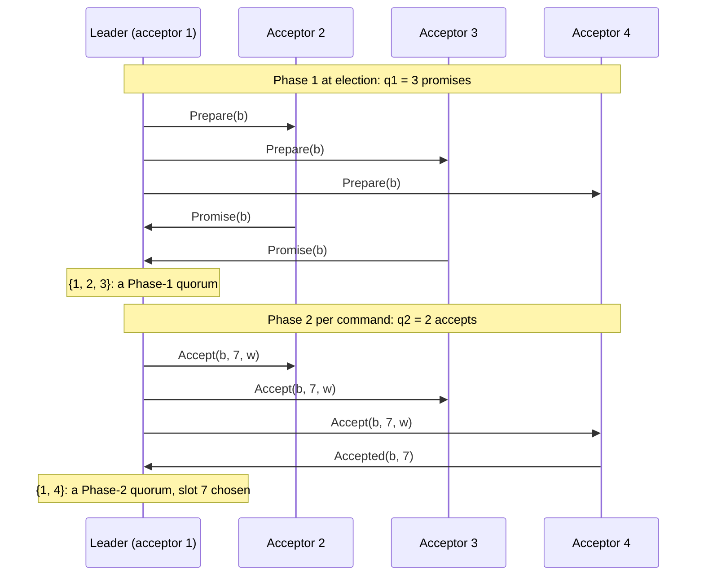

# Flexible quorums

Group: Quorums. Status: verified 2026-10-31.

Paxos safety needs every Phase-1 quorum to meet every Phase-2 quorum. It does **not** need two
Phase-1 quorums, or two Phase-2 quorums, to meet each other ([FPaxos §3]). So the two phases can
use different sizes: a small Phase-2 quorum `q2` for the common case, paid for by a large
Phase-1 quorum `q1` at the next election, with `q1 + q2 > n`. In paros a flexible split is
configuration data, `QuorumSystem::Flexible { q1, q2 }`, and every tally asks the configuration
which phase it counts for.

## 1. Problem

Classic Paxos uses majorities for both phases, so every quorum meets every other. Phase 2 runs
once per command and Phase 1 runs once per leader change, but both pay the same size. With an
even `n`, a majority wastes one acceptor: `n/2` accepts would be enough if Phase 1 takes
`n/2 + 1` ([FPaxos §4], "the freebie").

## 2. Model

The single-decree model ([single-decree-paxos.md](single-decree-paxos.md) §2). A quorum system
is two sets of acceptor sets, `𝒬₁` for Phase 1 and `𝒬₂` for Phase 2, with one requirement
([FPaxos §3]):

> **∀ Q1 ∈ 𝒬₁, ∀ Q2 ∈ 𝒬₂ : Q1 ∩ Q2 ≠ ∅**

For **simple quorums** (any acceptors count equally) this is `|Q1| + |Q2| > N` ([FPaxos §4]).

## 3. Roles and state

| What | Where | Durable? |
|---|---|---|
| The quorum system of a configuration | `AcceptorConfig::quorum_system()`, bound to the ballot with the members | yes, in the configuration |
| The Phase-1 tally (promises) | the election, the CTRL repair probe | no |
| The Phase-2 tally (accepts) | `Rounds`, a proxy leader, the CheckQuorum window, the GC fence | no |

A flexible split changes no role and no state. It changes only the answer of two predicates:
`has_phase1_quorum` counts against `q1` and `has_phase2_quorum` against `q2`.

## 4. Normal flow

The same as Multi-Paxos ([multi-paxos-log.md](multi-paxos-log.md) §4). Only the counts change.
With `n = 4`, `q1 = 3`, `q2 = 2`:

Every Phase-1 quorum of three meets every Phase-2 quorum of two, because `3 + 2 > 4`. Two Phase-2
quorums, `{1, 4}` and `{2, 3}`, do not meet, and that is safe.

## 5. Recovery flow

- **A leader change.** The new leader needs `q1` promises, more than a majority when `q2` is
  below a majority (`q1 = n − q2 + 1` at the tightest split). Phase 1 then meets every Phase-2 quorum of every lower ballot, so the P2c merge
  finds every value that could be chosen.
- **Progress within a phase** ([FPaxos §3]). When failures leave fewer than `q1` acceptors but
  `q2` or more, the current leader keeps deciding. A new leader cannot be elected until enough
  acceptors return.
- **A reconfiguration** may change the split. A successor configuration carries its own quorum
  system, and Phase 1 must hold a Phase-1 quorum of **every** configuration in the history
  ([matchmaking](matchmaking.md)).

## 6. Why it is safe

[FPaxos §5] proves final agreement with only `Q(p,2) ∩ Q(p',1) ≠ ∅`: if `v` is decided at `p`,
pick an acceptor in that intersection; it saw either `prepare(p')` first (so it refused
`propose(p, v)`, a contradiction) or `propose(p, v)` first (so the proposer of `p'` sees `v` or a
later value that is already `v`). The proof never uses Q1–Q1 or Q2–Q2 intersection. [GDC §4.1]
reaches the same result from write-once registers.

In paros the intersection is a constructor fact. `QuorumSystem::admits(n)` holds when
`1 <= q1 <= n`, `1 <= q2 <= n` and `q1 + q2 > n` (`cross_intersects`). Both constructors, `AcceptorConfig::new` and
`AcceptorConfig::zoned`, go through one private `build` that asserts `is_well_formed` once, so a
tally never re-checks it. A wire
boundary calls `admits` first and refuses a malformed configuration.

## 7. Liveness

- [FPaxos §4]: a simple split tolerates up to `|Q2| − 1` failures always, and up to `N − |Q2|`
  until a new leader is needed.
- An election needs `q1` live acceptors. A small `q2` makes leader changes fragile: `q2 = 1`
  means "any single acceptor learns a value in one hop, but recovery needs everyone up"
  ([FPaxos §4]).
- CheckQuorum asks for a **Phase-2** quorum (`Authority::holds`), so a leader keeps its authority
  (`Authority::holds`) as long as it can still decide (check-quorum card).

## 8. Costs

- Phase 2 waits for `q2` accepts, not a majority. A smaller `q2` lowers commit latency and
  tolerates slow acceptors.
- Phase 1 waits for `q1`, at each leader change.
- paros sends each `Accept` to the whole membership (`phase2_addressees`), not only to `q2` of
  them. [FPaxos §4] saves messages by addressing only `|Q2|` acceptors and retrying on the rest;
  paros does not take that latency trade (the `phase2_addressees` doc).

## 9. In paros

| What | Where |
|---|---|
| The quorum system | `paros-core/src/membership/quorum_system.rs`: `QuorumSystem::Flexible`, `phase1_quorum_size`, `phase2_quorum_size`, `cross_intersects`, `admits`, `is_phase1_quorum`, `is_phase2_quorum` |
| The configuration and its predicates | `paros-core/src/membership/acceptor_config.rs`: `AcceptorConfig::new`, `is_well_formed`, `has_phase1_quorum`, `has_phase2_quorum` |
| Matchmaker quorums (always majorities) | `QuorumSystem::is_majority`, an associated function that matches no variant |
| The sim's draw | `paros-sim/src/shape/quorum.rs`: `QuorumPolicy::Flexible`, `QuorumPolicy::system`, `tolerated_loss` |

The rule is stated in the root `AGENTS.md`: every quorum
question crosses `membership/`, predicates are phase-split, and no tally compares a count
against a threshold on its own.

**Sim gates and oracles:**

- The draw: `"a run draws a flexible quorum system"` (`shape/quorum.rs`). The policy clamps `q2`
  to `1..=n/2` per configuration and sets `q1 = n − q2 + 1`, the tightest split that still
  cross-intersects.
- Outcomes (`audit/state.rs`): `"flexible: an election completes under a flexible quorum
  system"`, `"flexible: a slot is decided by fewer accepts than a majority"`.
- Safety: `"a durable accept quorum never decides two values for a slot"` holds for every
  quorum system drawn.
- The copy budget: a flexible run may lose `q2 − 1` copies of a record (`tolerated_loss`), the
  number that keeps a full Phase-1 quorum of clean answers for CTRL.

**Divergences from the sources:**

- paros does not take [FPaxos §4]'s message saving (above).
- [FPaxos §7] weakens Phase 1 further: it needs to meet only the Phase-2 quorums **used** at
  lower ballots. paros's matchmakers are that idea for configurations: Phase 1 covers every
  configuration in the history `H_b` above the GC watermark, not every possible one
  ([matchmaking](matchmaking.md)).
- Matchmaker quorums and the handover's decree are majorities only (root `AGENTS.md`).

## 10. Pitfalls

- **A self-intersection assert.** Before #140 (flexible quorums), a well-formedness assert
  demanded that one phase's quorums meet each other. That forbids the whole point of the paper,
  an even cell deciding on `n/2` accepts (the `cross_intersects` doc; commit `42c3f10`).
- **A count where a predicate belongs.** An untagged `is_quorum` answered for both phases. It is
  gone: `phase1_quorum_size` and `phase2_quorum_size` only report how many answers a tally still
  waits for; whether a tally holds is always the phase's predicate (commit `42c3f10`).
- **A budget for the wrong phase.** A record lost on more than `q2 − 1` acceptors can leave no
  Phase-1 quorum of clean answers, so a faulty slot can never be decided again. The sim's copy
  budget is sized over the split, not over a majority (`tolerated_loss`).

## 11. Relatives

- [Grid quorums](grid-quorums.md): a quorum system where position, not count, decides.
- [Zone rule](zone-rule.md): a placement rule asked through the same two predicates.
- [Leadership fence and CheckQuorum](check-quorum.md): why the window counts a Phase-2 quorum.
- [Single-decree Paxos](single-decree-paxos.md): the proof the intersection serves.

## 12. Sources

- [FPaxos] Howard, Malkhi, Spiegelman, *Flexible Paxos: Quorum Intersection Revisited*:
  `docs/references/papers/flexible-paxos/transcript.md` §3 (the observation), §4 (majority,
  simple and grid quorums; message savings), §5 (the proof), §7 (dynamic quorums).
- [GDC] Howard, Mortier, *A Generalised Solution to Distributed Consensus*:
  `docs/references/papers/generalised-distributed-consensus/transcript.md` §4.1.
- frankenpaxos quorum systems: `docs/references/frankenpaxos/04-compartmentalization.md`
  (`grid.isWriteQuorum` in the proxy leader).

[FPaxos §3]: ../../references/papers/flexible-paxos/transcript.md
[FPaxos §4]: ../../references/papers/flexible-paxos/transcript.md
[FPaxos §5]: ../../references/papers/flexible-paxos/transcript.md
[FPaxos §7]: ../../references/papers/flexible-paxos/transcript.md
[GDC §4.1]: ../../references/papers/generalised-distributed-consensus/transcript.md
