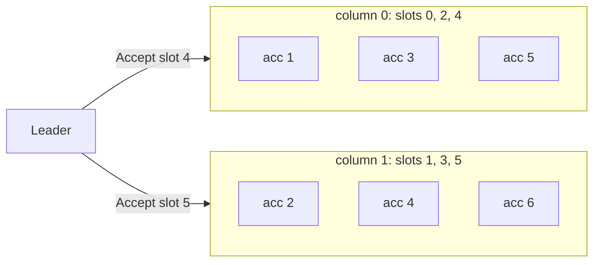

# Grid quorums (acceptor partitions)

Group: Quorums. Status: verified 2026-10-31.

Lay the acceptors out in a grid. A **column** decides a slot; a Phase 1 needs enough acceptors of
**every** column. Each slot's Phase 2 goes to one column only, so each acceptor sees `1 / cols`
of the commands and the acceptor tier's throughput grows with `cols` ([SRSM §3.2]). paros
generalizes the full-column grid to **acceptor partitions** (#532 (acceptor partitions)): a
column is a partition of `2F+1` acceptors, a majority of one partition decides, and a majority
of every partition elects.

## 1. Problem

With majority quorums, every command is processed by at least half the acceptors. Adding
acceptors does not reduce the load on each one ([SRSM §3.2]: "each acceptor handles ≥ half of
all commands"). The acceptor tier cannot scale out.

## 2. Model

The flexible-quorum model ([flexible-quorums.md](flexible-quorums.md) §2): only Phase-1 and
Phase-2 quorums must meet. A grid is a quorum system where **position**, not count, decides
membership in a quorum ([FPaxos §4], grid quorums; [WPaxos §3.1]: which nodes fail matters, not only how many).

## 3. Roles and state

| What | Where | Durable? |
|---|---|---|
| The layout `rows × cols` and `acks` | `QuorumSystem::Grid { rows, cols, acks }` in the configuration | yes, bound to the ballot |
| A member's place | member `i` of the sorted membership sits at `(i / cols, i % cols)` | derived |
| A slot's column | `slot % cols` (`QuorumSystem::column_of`) | derived |
| A round's column | recorded in the open `Round` (`Round::column`), with a move count | no |

The layout is a pure function of the configuration, so every node derives the same grid. The
core has no RNG, so a slot's column is the modulus, not a draw (the `column_of` doc; frankenpaxos
draws `grid.randomWriteQuorum()`).

**The quorums** (the `QuorumSystem::Grid` doc):

- **Phase 2:** any `acks` acceptors of one column.
- **Phase 1:** any `rows − acks + 1` acceptors of every column.
- Inside one column, `(rows − acks + 1) + acks > rows`, so the two counts overlap: every Phase-1
  quorum meets every Phase-2 quorum by construction. Acks from two columns never add up.

Two shapes matter:

- **Full-column grid**, `acks = rows` (`QuorumSystem::grid`): Compartmentalized Paxos's grid. A
  column decides only when whole; Phase 1 needs one acceptor of every column (any full row is
  one) ([SRSM §3.2]; [FPaxos §4]).
- **Acceptor partitions**, `rows = 2F+1`, `acks = F+1` (`QuorumSystem::partitions`): what
  `parosctl` offers. Each column is a majority group of its own.

## 4. Normal flow

A `3 × 2` grid of partitions (`F = 1`): six acceptors, two columns of three.

1. The leader opens slot `s` in column `s % cols` and sends its `Accept` to that column only
   (`phase2_addressees`).
2. `acks` accepts of that column decide the slot (`has_phase2_quorum_in`). An `Accepted` from
   outside the round's column is not counted (`is_phase2_addressee`).
3. An election sends `Prepare` to everyone (which column will answer is not known ahead) and
   needs `rows − acks + 1` promises in every column.
4. On a full-column grid (`acks = rows`), a quorum read addressed to a row is answered by that
   row. On a partition grid a read needs `rows − acks + 1` of every column, so it goes to
   everyone (`row_of`; [leaderless reads](leaderless-reads.md)).

## 5. Recovery flow

- **A stuck column.** A column that cannot reach its `acks` (one acceptor down on a full-column
  grid, `F+1` down in a partition) holds its slots, and the apply walk stalls behind the first.
  The driver moves a round that stayed open for its budget of re-sends to the next column, with
  the same slot, ballot and command (`ColocatedNode::move_round`, #533 (move a stuck round)). The
  budget doubles with each move, up to `MOVE_BACKOFF_CAP` = 6 doublings (`move_budget`,
  `paros-roles/src/node/grid.rs`).
- **A leader change.** Phase 1 holds `rows − acks + 1` of every column, so it meets the Phase-2
  quorum of every column at every lower ballot. The P2c merge works unchanged.
- **A reconfiguration between grids, or between a grid and a majority.** Phase 1 needs a
  Phase-1 quorum of every configuration in the history, so a row of the old grid too
  (reconfiguration cards, planned).

## 6. Why it is safe

The FPaxos argument ([flexible-quorums.md](flexible-quorums.md) §6) needs only Phase-1 ∩ Phase-2
≠ ∅. In a grid that intersection is inside one column, true for any `rows` and `cols` when
`1 <= acks <= rows` (`cross_intersects`).

Moving a round is safe for the same reason ([`move_round` doc]): inside one ballot a slot has one
value, so votes left in the old column are harmless; every column is a Phase-2 quorum group and
every Phase-1 quorum meets each of them, so a later election finds the value or proves it was not
chosen. Slots are independent, so the new column needs no backfill.

`QuorumSystem::admits` refuses a layout that does not tile the membership (`rows * cols == n`),
because a short row or column would let a predicate answer for a cell that does not exist.

## 7. Liveness

- Steady state survives `rows − acks` failures **in each column**. On a full-column grid that is
  zero: one dead acceptor freezes its column until the leader moves the round.
- An election needs `rows − acks + 1` live acceptors in every column. A partition that lost a
  majority stops elections, and so stops every later reconfiguration.
- Which acceptors fail matters, not only how many ([WPaxos §3.1]: `Fmin` and `Fmax`).

## 8. Costs

- Each acceptor processes `1 / cols` of the commands ([SRSM §3.2]).
- An election and a quorum read need answers from every column: a larger Phase 1. [SRSM §3.2]
  calls it an acceptable trade, "since Phase 1 only runs on leader failure".
- The `paros-bench` load generator's `--topology 3x1,3x2,3x3` compares a majority (`3x1`, one
  partition) with grids on one seed (added as a `parosctl bench` flag in commit `eb75cbf`).

## 9. In paros

| What | Where |
|---|---|
| The quorum system | `paros-core/src/membership/quorum_system.rs`: `QuorumSystem::Grid`, `grid`, `partitions`, `phase1_per_column`, `column_of`, `is_phase1_quorum_in`, `is_phase2_quorum_in`, `phase2_addressees` |
| The configuration's view | `paros-core/src/membership/acceptor_config.rs`: `has_phase1_quorum_in`, `has_phase2_quorum_in`, `column_of` |
| Moving a stuck round | `paros-core/src/node/policy.rs`: `ColocatedNode::move_round`; `paros-roles/src/node/grid.rs`: `move_stuck_rounds`, `move_budget`, `MOVE_BACKOFF_CAP` |
| The column choice | `ColocatedNode::propose_in` (a column away from slow members in production, #361 (slow machines)); `paros-roles/src/node/grid.rs`: `phase2_column` (a BUGGIFY site, inert in production) |
| The sim's draw | `paros-sim/src/shape/quorum.rs`: `QuorumPolicy::Grid`, `grid_layouts` |

**Sim gates and oracles:**

- Draws (`shape/quorum.rs`): `"a run draws an acceptor grid"`, `"a run draws acceptor
  partitions"`, `"a run draws the wide-grid scenario"`. The harness runs only layouts with
  `rows >= 2` and `cols >= 2` (`grid_layouts`): a `1 × n` or `n × 1` grid is a permanent
  partition under attrition.
- Outcomes (`audit/state.rs`): `"grid: a slot is decided on a column"`, `"grid: an election is
  covered by a row"`, `"grid: an election is covered by a row across a reconfiguration"`,
  `"grid: a reconfiguration moves between a grid and a majority"`.
- Driver sites (`paros-roles/src/node/grid.rs`): `"grid: the driver moves a stuck round"`,
  `"grid: the driver backs off a moved round"`, `"grid: the driver skips a column when it moves
  a round"`, `"grid: the driver overrides a round's column"`.
- `"grid: a slot is decided on a column other than its own"` is in `gates::RARE`
  (`paros-sim-runner/src/gates.rs`).
- `"gc: a leader never runs a grid configuration naming a retired identity"`
  (`audit/node.rs`): a grid tolerates no member lost for good.

**Divergences from the sources:**

- [SRSM §3.2] and [FPaxos §4] use full rows and full columns. paros's `acks` lets a column decide
  on a majority of itself (acceptor partitions, #532).
- frankenpaxos, in its flexible mode, picks a random grid write quorum; paros uses `slot % cols`, so a successor or a
  restarted leader re-derives the same column.
- [WPaxos §3.1] builds its grid on zones. paros's grid is positional over sorted ids and cannot
  express zone survival; the zone rule applies per partition instead
  ([zone-rule.md](zone-rule.md)).

## 10. Pitfalls

- **A round that flips forever.** A move resets the round's tally, so the new column must collect
  all its acks inside the budget. Under load, a budget of one to three re-sends was shorter than a
  round trip: a `Grid { rows: 3, cols: 2 }` leader moved its rounds 9,844 times and the apply
  walk stalled at slot 14 of 19 decided. The doubling budget fixed it (CI run 38823114601 at
  `629aa62`, the `move_budget` doc).
- **Two column-mates that duel.** An unbounded `contest_overwrite` let two acceptors of one
  column of a `Grid{2,2}` contest a slot until the deadline. Each contest now runs once per
  acceptor (#396, commit `e5dfd6a`, witness 256737527381630171).
- **A grid loses no copy for good.** Every slot's Phase 2 goes to one column, so one acceptor
  lost for good freezes its column's slots for ever. The sim's copy budget is zero on a grid
  (`QuorumPolicy::tolerated_loss`).
- **Columns in one zone.** A column inside one failure domain commits alone, and after its loss
  it blocks every later reconfiguration. The zone rule refuses it per partition.

## 11. Relatives

- [Flexible quorums](flexible-quorums.md): the theory the grid instantiates.
- [Zone rule](zone-rule.md): applied per partition.
- [Proxy leaders](proxy-leaders.md): the other half of [SRSM §3]; a proxy fans a round out to its column.
- [Leaderless quorum reads](leaderless-reads.md): a read addressed to one row.

## 12. Sources

- [SRSM] Whittaker et al., *Scaling Replicated State Machines with Compartmentalization*:
  `docs/references/papers/scaling-rsm-compartmentalization/transcript.md` §3.2 (acceptor grids).
- [FPaxos] *Flexible Paxos*: `docs/references/papers/flexible-paxos/transcript.md` §4 (grid
  quorums; the `|Q1| = 1, |Q2| = N` thought experiments, which paros maps to `1 × n` grids).
- [WPaxos] *WPaxos: Wide Area Network Flexible Consensus*:
  `docs/references/papers/wpaxos/transcript.md` §3.1 (grid quorums over zones, `Fmin`, `Fmax`).
- frankenpaxos: `docs/references/frankenpaxos/04-compartmentalization.md` (the proxy leader's
  `grid.randomWriteQuorum()`).

[SRSM §3.2]: ../../references/papers/scaling-rsm-compartmentalization/transcript.md
[SRSM §3]: ../../references/papers/scaling-rsm-compartmentalization/transcript.md
[FPaxos §4]: ../../references/papers/flexible-paxos/transcript.md
[WPaxos §3.1]: ../../references/papers/wpaxos/transcript.md
[`move_round` doc]: ../../../crates/lib/paros-core/src/node/policy.rs
