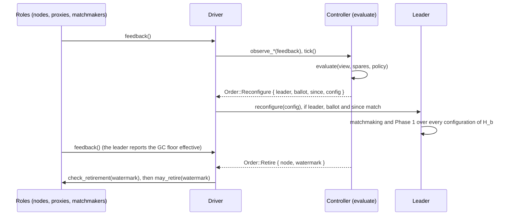

# The journal controller

Group: Operations. Status: written 2026-11-26.

The **journal controller** reads the feedback of the roles of one journal and decides at most
one order: replace a silent acceptor with a spare, or retire a node that left
every configuration. It is a pure function, `controller::evaluate(view, spares, policy)`, and
each order is a call that a driver already makes. It adds no message, no term and no state to
the protocol.

## 1. Problem

A replicated state machine must replace a machine that failed, and this replacement is a
reconfiguration [MMP §Abstract]. Paxos and Matchmaker Paxos say how to reconfigure safely. The choice
of a new configuration is orthogonal to the protocol: an administrator or an external service
makes it [MMP §4.2]: in Vertical Paxos an auxiliary configuration master "determines the set of acceptors and
the leader for every configuration" [VP §2]; in Northguard a coordinator tracks the replica set
of each segment and re-replicates the sealed segments that are under-replicated [NG, "Metadata"].

Without such a component a person must watch each journal. A journal that lost an acceptor
still works, so nothing tells the person. Fault tolerance masks a fault and silently lowers the
tolerance, as Paxos Made Live reports for a misconfigured replica [PML §6.3, "unsolved
challenge"]. Goal 11 of paros asks that the service
heal with no person in the loop (`docs/architecture/01-goal.md` §1.1).

## 2. Model

- The same crash-recovery, asynchronous model as the roles. The controller is safe under any
  delay of its inputs: the protocol keeps safety whatever the orders say, so a late or wrong
  view costs work, never a value.
- No clock crosses two processes. The age of a feedback is counted in ticks of the holder of the
  view (`View::tick`), and the thresholds are counts of inputs (`Policy::max_age`,
  `Policy::silent_windows`), never times.
- A controller can restart, and two controllers can run at once with views of different ages.
  Who runs one controller at a time is the duty of the caller (the cell, in the service).
- The controller is control plane, the journal is data plane. A data plane must keep working
  when its control plane is down [AWS §6.1, "static stability"]: a journal with no controller
  keeps its configuration and serves.

## 3. Roles and state

| Party | State | Durable? |
|---|---|---|
| Each deployment (`ColocatedNode`, `ProxyLeader`, `ReplicaNode`, `Matchmaker`) | `feedback()`: metrics and insights of what the role does itself (`contract/feedback.rs`) | no, computed on each call |
| Leader | `Authority::missed`: for each member, the `CheckQuorum` windows in a row it missed | no, volatile |
| Controller | `View`: the last feedback of each party and its age in ticks | no: a controller that restarts has an empty view |
| Caller | the spares it offers (`Spare`: a node and an optional failure domain) and the `Policy` | the caller's choice |

Each role reports only what it does itself. The leader reports its quorum window
(`LeaderFeedback::missed`, `NodeInsight::MemberSilent`), a proxy leader its Phase 2
(`ProxyInsight::ColumnSilent`, `ProxyInsight::ColumnBlocked`), a node its retire mark and the
floor it heard (`NodeInsight::RetirementUnchecked`, `NodeInsight::MayRetire`).

## 4. Normal flow

The rules are one ordered table (`controller/rules.rs`, rules 1 to 14); the first rule that
applies gives the decision. Rules 1 to 4 hold when the view cannot judge: no fresh leader, a
higher ballot, no majority of matchmakers (or a matchmaker reports a configuration in force
above the leader's), no Phase-1 quorum of fresh members. Rule 6 retires a
node outside each configuration in force once the leader made a GC floor effective. Rule 7 is
`Steady` when no member is silent. Rules 8 to 11 and 13 hold when a replacement would not be
live at once (rule 12 is an assertion), and rule 14 orders the replacement.

## 5. Recovery flow

- A controller that restarts has an empty view, and rule 1 holds until feedback arrives.
- A leader that changes drops each order for the old leadership: the driver compares the
  leader, the ballot and `since` of a `Reconfigure` with the node before it calls `reconfigure`.
- A leader refuses a `Reconfigure` unless a recent proof of its leadership is a Phase-1 seal of
  each configuration in force (`ReconfigureRefusal::Unproven`). The proof is the acks of the open
  `CheckQuorum` window, the acks of the last window that closed, or the promises of the election
  it won. The caller asks again after the next window.
- After a `Retire` order, the matchmakers check the node's registrations. Once the mark is
  checked, rule 6 gives no more orders for that node, and the node's own `may_retire` decides,
  at its driver.

## 6. Why it is safe

The controller adds nothing that safety rests on. Each order is a call that the protocol already
judges:

- A `Reconfigure` is a round change of Matchmaker Paxos [MMP §3.1–§3.3, §4.2]: the new leader
  registers `(b, C_new)` at the matchmakers and runs Phase 1 over every configuration of `H_b`.
  Any `C_new` is safe [MMP §3.3]. A `C_new` with no live Phase-1 quorum can stall the journal,
  so rule 13 gives an order only for a `C'` whose fresh nodes can run both phases.
- A `Retire` passes the six legs of `ColocatedNode::may_retire` (`node/gc.rs`). The GC floor is
  the one of the paper [MMP §3.4–§3.5]. The sixth leg is a rule of paros, not of the paper:
  every matchmaker agrees that no registration at or above the floor names the node (#1002
  (retire fence gaps), root `AGENTS.md`, "Retire carries the evidence").
- Two controllers can give opposite orders: one retires node `n`, the other names `n` in a new
  configuration. The matchmakers decide alone: a matchmaker that holds a registration that names
  `n` above the floor refuses the check, and one that agreed refuses each later registration that
  names `n` (`MatchRefusal::Retired`). `specs/tla/retire-fence/` checks this
  (`two_controllers`, with the control `two_controllers_reach`; §4.8.1 of `docs/architecture/`).

## 7. Liveness

- Each order needs fresh feedback from a matchmaker majority and from a Phase-1 quorum of the
  configuration in force (rules 3, 4). A `Reconfigure` also needs the fresh nodes to be a
  Phase-1 quorum of `C'` that holds a Phase-2 quorum of each column of `C'` (rule 13). So an
  order that the controller gives can finish with the nodes that run.
- A member is replaced only on two witnesses: the leader missed it for at least
  `Policy::silent_windows` windows in a row,
  and the member sent no fresh feedback. A member that runs again stops being silent.
- A replacement waits for the GC of earlier configurations (rule 9), so the configurations in
  force are one when it starts.
- The `healing` walk of `consensus-sim` judges liveness as Paxos Made Live tests it: faults
  first, then a quiet phase where progress must come [PML §6.3]. Every policy tried heals every
  seed; the heal takes 9 to 82 control rounds after the faults stop (p50 24, p99 59; the doc of
  `POLICY` in `cluster/control.rs`). The bound depends on the walk; no source gives one.

## 8. Costs

- No message and no write in the protocol. The feedback is a read of state that each role holds.
- `evaluate` is a pure function over the view, with no I/O.
- A replacement costs one reconfiguration: a matchmaking round trip and a Phase 1 over the
  configurations of `H_b`, almost always one earlier configuration [MMP §4.2, §4.5], with no
  stall when the Phase-1 bypass applies [MMP §4.4]. Reconfiguring once a second changed the
  median latency and throughput by less than about 4 %, often about 2 % [MMP §7.1].

## 9. In paros

- `controller.rs` (`Spare`, `Policy`, `Decision`, `Order`, `HoldReason`), `controller/view.rs`
  (`View`), `controller/rules.rs` (`evaluate`, rules 1 to 14). A module of `paros-consensus`, in
  the roles layer; it uses only `contract`, `membership` and `types` (§4.8.3).
- `contract/feedback.rs`: `NodeFeedback`, `LeaderFeedback`, `ProxyFeedback`,
  `MatchmakerFeedback`, `ReplicaFeedback`, `NodeInsight`, `ProxyInsight`. Each deployment has
  `feedback(&self)`.
- `proposer/authority.rs`: `Authority::missed`, the windows in a row that each member missed.
- `node/reconfigure.rs`: `ReconfigureRefusal::Unproven`.
- Judges: the table tests of `controller/rules.rs`; the core probes "controller: rule 6 orders a
  node outside the configuration to retire" and "controller: rule 14 orders a spare in place of
  a silent member"; the `healing` flavor of `consensus-sim` (`cluster/control.rs`), where a
  member stops for good when the faults stop and two controllers (one with a view 8 rounds late)
  heal the journal; the oracles `HEALED` and `NO_FALSE_SILENCE` (`oracle/healed.rs`) with the
  mutants `DropOrders`, `DropRetires` and `LateView`; the trace check of the walk against
  `node/MatchmakerTrace`.
- Departures from the sources: none in the protocol. The thresholds `max_age` and
  `silent_windows` have no source and no default in the core: the walk heals with every value it
  tried (§4.8.4).

## 10. Pitfalls

- **A leader that is not the leader any more.** An order for an old leadership could replace a
  member of a configuration that a newer leader already changed. The order carries the leader,
  its ballot and `since`, and the driver drops it on a mismatch.
- **A stale proof of leadership** (PR #1575 (proven leadership)). A leader that lost its quorum
  can still believe it leads for one window. `Unproven` refuses its reconfiguration unless the
  members that acked are a Phase-1 seal of each configuration in force.
- **A round open at a chosen slot** (PR #1575 (proven leadership)). The coverage gate found a leader that kept a round
  open at a slot that it learned chosen at an older ballot, and so never settled. A learn now
  closes the round open at its slot (`close_chosen_round`, `node/learn.rs`).
- **A checked node that never retires** (PR #1578 (healing walk), found by its independent review).
  Rule 6 orders no more once the mark is checked, so a driver that calls `may_retire` only on an
  order leaves a checked node running. The node's driver keeps the order and calls `may_retire`
  until the node retires (`Controllers::retiring`, `cluster/control.rs`); `HEALED` requires that
  the node retires, and `Mutant::DropRetires` is its control.
- **A grid moves members.** A spare of the same failure domain does not always keep the zone rule
  of a grid, because a grid places members by their sorted position. Rule 13 checks the zone rule
  of the new configuration (§4.8.2).

## 11. Relatives

- [reconfiguration](reconfiguration.md): the `Reconfigure` order is a round change.
- [configuration-gc](configuration-gc.md): the `Retire` order and the effective floor.
- [check-quorum](check-quorum.md): the windows that give the silent members and the proof of
  leadership.
- [proxy-leaders](proxy-leaders.md): the columns that a proxy leader reports.
- [zone-rule](zone-rule.md): the shape that a replacement keeps.

## 12. Sources

- [MMP] Matchmaker Paxos, `docs/references/papers/matchmaker-paxos/transcript.md`: §Abstract
  (reconfiguration replaces failed machines), §3.1–§3.5, §4.2 (the choice of a configuration is
  outside the protocol), §4.4, §4.5, §7.1.
- [VP] Vertical Paxos, `docs/references/papers/vertical-paxos/transcript.md` §2 (an auxiliary
  configuration master decides the configurations).
- [NG] LinkedIn Northguard, `docs/references/articles/linkedin-northguard.md`, "Metadata" (the
  coordinator tracks the replica set of each segment and re-replicates under-replicated sealed
  segments).
- [PML] Paxos Made Live, `docs/references/papers/paxos-made-live/transcript.md` §6.3 (tests in
  safety mode, then liveness after the faults stop; fault tolerance masks a lowered tolerance).
- [AWS] Cell-based architecture, `docs/references/papers/aws-cell-based-architecture/transcript.md`
  §6.1 (control plane and data plane, static stability).
- paros: `docs/architecture/04-8-journal-controller.md` §4.8, `specs/tla/retire-fence/`,
  `crates/lib/paros-consensus/src/controller/rules.rs`.
