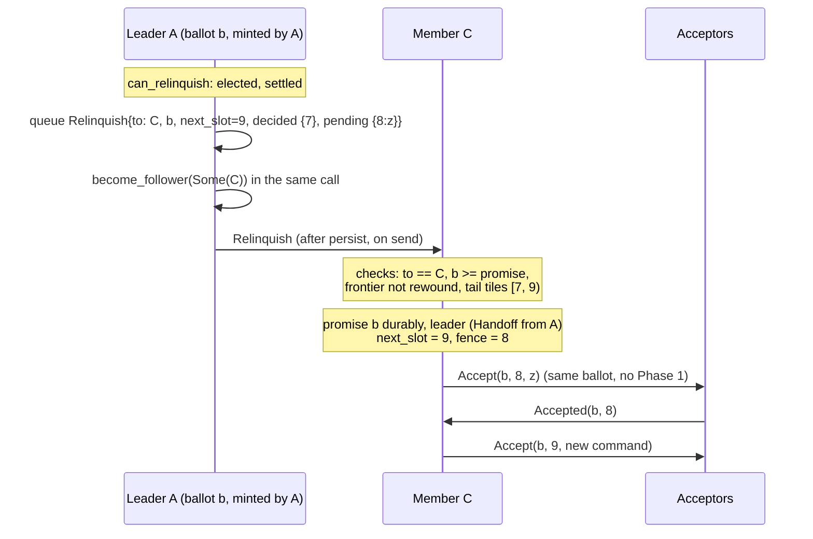

# Leader handoff

Group: Leader. Status: verified 2026-10-31.

A live leader can give its **Phase-2 authority** (its ballot, its allocator frontier and its
unfinished rounds) to one named member with one `Relinquish` message. The successor continues
Phase 2 **under the same ballot**, with no Phase 1. The old leader abdicates in the same call
that queues the message. paros calls this the cooperative handoff (`relinquish_to`); the
source is DPaxos's *Leader Handoff* ([DPaxos §4.4]).

## 1. Problem

There are two reasons for a new leader ([DPaxos §4.4]): the leader **failed**, or the leader is
alive but should **move** (a clean stop of its machine, a planned drain). An ordinary election
destroys the authority: the successor bumps the ballot, runs Phase 1, and finds again the log
suffix that the old leader already knew. When the old leader is alive and helps, that round
trip is waste. The old leader already holds a Phase-2 authority that a Phase 1 established; it
can send it.

The danger is the one Paxos safety rests on: **one proposer per ballot**. If two nodes propose
different commands under one `(slot, ballot)`, two accept quorums can form, and two values are
chosen for one slot.

## 2. Model

- The same crash-recovery, asynchronous model as the election card. The `Relinquish` message
  can be lost, delayed, duplicated, reordered or sent to the wrong node.
- No acknowledgement and no retry: the handoff is one message.
- Both nodes are members of the leader's configuration (`handoff_candidates`).

## 3. Roles and state

What a paros leadership holds, and what travels (from the module doc of `node/handoff.rs` and
[the design note]):

| State | Transferred? | Why |
|---|---|---|
| `ballot` | yes | the authority itself; what acceptors gate on |
| `next_slot` (the allocator frontier) | yes | keeps "one proposer per ballot" true across a change of node |
| open Phase-2 rounds in `[first_unchosen, next_slot)` | yes, as `pending` commands | the P2c work the predecessor has not finished |
| chosen slots in the same range | yes, as `decided` `(Ballot, Command)` | the same claim a `Commit` makes |
| the promise | no, **raised** at the successor | durable; the install's only write |
| the fence | derived: `next_slot - 1` | the same rule as a fresh leader's fence |
| the CheckQuorum window | reset | fresh-leadership state |
| an open election, recovery, repair probe, faulty records | no, **the handoff is refused** | Phase-1-shaped work, tied to the quorum that reported it |

The successor also records how it got the leadership: `LeadershipOrigin::Handoff { from }`
(the ballot names the predecessor, not itself) versus `LeadershipOrigin::Elected`.

## 4. Normal flow

1. The driver asks `can_relinquish()`. It is true only for a leader that was **elected** (not
   installed), is settled (no election, matchmaking, recovery or repair probe open, no faulty
   record), is not below its own promise, has more than one member, and whose tail
   `next_slot - first_unchosen` fits in `HANDOFF_BATCH`.
2. `relinquish_to(target)` splits `[first_unchosen, next_slot)` into `decided` and `pending`,
   asserts that they tile the range exactly (`tail_shape_valid`), queues
   `Relinquish { from, to, ballot, from_slot, next_slot, decided, pending, config }`, and calls
   `become_follower(Some(target))` **in the same call**.
3. The successor's `on_relinquish` checks addressing (`to == me`, both ids in the pool), staleness
   (`ballot` not below its promise, not already held, frontier not rewound), shape
   (`tail_shape_valid`) and fitness (no faulty records).
4. It installs: raises its promise to `ballot` durably, becomes leader with
   `LeadershipOrigin::Handoff`, adopts `next_slot` verbatim, opens a fresh authority with fence
   `next_slot - 1`, learns every `decided` slot (`mark_chosen`), and opens a recovery of
   `pending` with `RecoveryPolicy::Inherited`.
5. `pump_leader_recovery` re-proposes each pending command verbatim at the same ballot. A slot
   nobody described is skipped (`RecoveryStep::Undescribed`), never filled.

## 5. Recovery flow

- **The message is lost.** A already stepped down, so nobody leads. The next election timeout
  starts an ordinary election, which runs Phase 1. Availability cost only ([DPaxos §4.4]: "If the
  `relinquish()` message is lost, neither the old nor the new leader may act as leader").
- **The message is duplicated or sent to the wrong node.** The payload names `to`. Any other
  node refuses it (`rejected_target`). A second copy at C finds the authority already held or
  the frontier already past (`rejected_stale`).
- **A crashes, before or after the send.** Leadership is volatile: A boots as a follower, and
  its next campaign is at a strictly higher round. There is no durable "I lead at `b`" to bring
  back.
- **C crashes after the install.** C's promise is at `b` and its records hold every round it
  opened (`record_own_round`), so it reboots with the frontier it had and refuses a replayed
  `Relinquish` that would rewind it. An ordinary election follows.
- **C cannot cover the inherited fence.** C never ran Phase 1 over `[from_slot, next_slot)`. If
  a decision only A knew becomes unreachable, C's chosen prefix stops below the fence. After
  `HANDOFF_FENCE_ELECTIONS` (3) election timeouts, `tick_handoff_fence` resigns, and an
  ordinary Phase 1 recovers the range.
- **A higher ballot appears.** C steps down by the ordinary rules (`Nack`, `Prepare`, beat).

## 6. Why it is safe

The rule is [DPaxos §4.4]: a leader sends `relinquish()` **at most once** for a slot, and after
it sends it, it **never acts as leader** for those slots again. paros makes each half
structural instead of checked:

1. **Abdication is synchronous.** `relinquish_to` queues the message and demotes the node in one
   call on the single-threaded core. The message cannot exist without the abdication, and it
   cannot reach the transport before the `Ready` batch that holds it.
2. **A crash is an abdication.** `ColocatedNode::new` boots a follower. Only two paths set
   `Leader`: `try_become_leader`, from `Candidate` and only at a fresh round strictly above the
   promise and the operating ballot (`next_campaign_round`), and `on_relinquish`, for a ballot
   another node minted and sent to it. A restarted A minted `b` and nobody may hand `b` back to
   it (rule 5), so A can never lead at `b` again.
3. **The successor is in the payload.** The transport is never trusted with uniqueness.
4. **The successor checks its own durable promise and frontier.** `ballot < promised` means
   some node already ran Phase 1 past `b`. A frontier below its own means a replay.
5. **One hop only.** Only the node that minted `b` by winning Phase 1 may relinquish it
   (`LeadershipOrigin::Elected` in `can_relinquish`). This closes the multi-hop replay of §10.
6. **Verbatim re-proposal.** The successor re-proposes each pending command unchanged at the
   same `(slot, ballot)`, which is idempotent for P2b. It never invents a value: without a
   Phase-1 report, a `Noop` could overwrite a value chosen under an older ballot. That is why
   `RecoveryPolicy::Inherited` skips and the payload must tile the range exactly.

Together: for a given ballot, at most one physical node exercises Phase 2 at a time. That is
the premise of [PMMC §2] commander invariant **C1** (at most one commander per ballot and slot),
from which A4 and the rest of the safety proof follow.

## 7. Liveness

- A handoff never blocks: a refusal at either end costs at most one ordinary election.
- The successor must be able to finish the tail. Its chosen prefix must reach the inherited
  fence within `HANDOFF_FENCE_ELECTIONS` election timeouts, or it resigns.
- A tail larger than `HANDOFF_BATCH` (the size of one `Promise` page) is refused; the leader
  keeps leading.
- Too many handoffs starve elections. In the sim, a handoff replaces an election, so a high
  rate makes it the main way leadership moves (see §10).

## 8. Costs

- One message, one hop: no Phase 1 round trip and no promise write at a quorum.
- One durable write at the successor (the promise raise), flushed before its first `Accept`.
- The payload is at most `HANDOFF_BATCH` slots.
- Compared with an election: it saves one Phase-1 round trip, a quorum of promise writes, and
  the election timeout the cell waits before anyone campaigns.

## 9. In paros

| What | Where |
|---|---|
| Eligibility, the send, the abdication | `paros-core/src/node/handoff.rs`: `can_relinquish`, `handoff_candidates`, `relinquish_to` |
| The install and its guards | same file: `on_relinquish`, `tail_shape_valid`, `HandoffCounters` |
| The inherited-fence deadline | same file: `tick_handoff_fence`, `HANDOFF_FENCE_ELECTIONS`, `HANDOFF_BATCH` |
| How the leadership started | same file: `LeadershipOrigin` |
| What a fill needs | `paros-core/src/proposer/recovery.rs`: `RecoveryPolicy::Inherited`, `RecoveryStep::Undescribed` |
| The durable frontier | `paros-core/src/node/phase2.rs`: `record_own_round` |
| Who calls it | `paros-roles/src/node/stop.rs`: `hand_on` (a clean stop hands each leadership on, #560); `paros-roles/src/node/shared.rs`: `offer_handoff` (the driver's BUGGIFY site) |

The rule is stated in the module doc of `node/handoff.rs` (what authority is, why no durable
fence is needed, authority uniqueness) and in the doc of `can_relinquish` (one hop only). The
full design note is [the design note]. AGENTS.md lists it under "Protocol invariants to
remember".

**Sim gates and oracles** (`paros-sim/src/audit/`). The oracle rebuilds authority from wire
events (`Accept` sent means "exercises", `Relinquish` sent means "released"), never from the
node's role:

- `"a relinquished authority is never exercised again"`,
  `"one physical node at a time exercises a logical Paxos authority"`,
  `"only the node exercising an authority relinquishes it"`,
  `"a transferred allocator frontier never rewinds"` (`state.rs`).
- `"a relinquished tail exactly tiles the transferred range"`,
  `"an inherited allocator frontier never rewinds"` (`node.rs`).
- Reach gates: `"a successor installs a transferred authority"`,
  `"a handed-over authority continues Phase 2 without another Phase 1"`,
  `"an inherited authority streams Phase 2 with no Phase 1 of its own"`,
  `"proxy: a delegated round survives a leader handoff"` (`state.rs`).
- Downstream: `"one ballot proposes at most one command for a slot"` (`state.rs`).

**BUGGIFY sites** (in `paros-roles`, never in `paros-core`):

- `initiate_handoff` (`paros-roles/src/node/draws.rs`): 0.03 for a leader still healing a hole,
  0.02 for a leader with an unchosen tail, 0.002 for a settled leader, plus the handoff-storm
  scenario (`paros_observe::scenario::hand_off`, #484).
- The target: 0.5 to pin the lowest-id candidate, so a seed can bounce leadership between two
  nodes (`offer_handoff`, `paros-roles/src/node/shared.rs`).
- Drop and duplicate a `Relinquish` at 0.25 each (`paros-roles/src/node/transport.rs`).

Unit tests: `paros-core/src/node/tests/handoff.rs`, for example
`an_installed_authority_is_never_handed_on_again`,
`a_restart_cannot_resurrect_a_relinquished_authority`,
`a_handoff_never_no_op_fills_a_slot_nobody_described`.

**Divergences from the sources:**

- [DPaxos §4.4] does not limit how many times an authority moves and does not discuss a replayed
  `relinquish()`. paros allows **one hop**: only the minter
  of a ballot relinquishes it. A second move costs an ordinary election.
- [DPaxos §4.4] ties the successor to the replication quorums the old leader declared in its
  intents (Expanding Quorums). paros has no intents; the payload carries the configuration
  (`config`) on a matchmaker deployment, and the plain path keeps its static configuration.
- etcd-raft's leader transfer ([etcd-raft §6], `raft.go:1628`, `raft.go:1750`) is a **forced
  election**: the old leader stops taking proposals, brings the target up to date, and sends
  `MsgTimeoutNow`; the target campaigns at a higher term. The old leader aborts after one
  election timeout and keeps leading. paros moves the ballot itself, abdicates at once, and has
  no abort path.

## 10. Pitfalls

- **The multi-hop replay.** The first version let C hand on to D. A duplicate of A's original
  `Relinquish` then reached C again. C was an ordinary acceptor at `b` and the payload named
  it, so every wire guard passed, and C installed `b` a second time while D exercised it. The
  sweep went red on "a relinquished authority is never exercised again" and "one physical node
  at a time exercises a logical Paxos authority". A durable relinquish record would fix it at
  the cost of a new `HardState` field; the one-hop rule fixes it with none
  (`can_relinquish` doc).
- **A rewound frontier.** The proxy model checker (seed 756) found a delegated round that left no
  record at the leader. The successor crashed, rebooted with its frontier rewound, and a
  duplicated `Relinquish` re-installed the authority: one slot allocated twice at one ballot.
  `record_own_round` makes the frontier durable by construction.
- **The leader hint.** `on_accept` takes the leader hint from the `Accept`'s `leader` field
  (first the sender, now an explicit field so a proxy can carry it), never from `ballot.node`.
  After a handoff the two differ, and keying on `ballot.node` sent clients to the node that had
  stepped down ([the design note], "Client proposals across the boundary").
- **Never fill without a report.** A handoff ran no Phase 1, so an undescribed slot is unknown,
  not free. `tail_shape_valid` requires exact tiling, and `RecoveryPolicy::Inherited` skips.
- **The rate.** At 0.30 for a healing leader, handoffs moved leadership every few ticks and
  starved every campaign that needs a settled cell. The rates are now near the resignation
  site's 0.004 (`initiate_handoff` doc).
- **GC after a handoff (#529).** A handed-on leadership on a matchmaker deployment must collect
  like an elected one, or an operator waiting on the GC watermark waits for as long as the
  successor leads (witness 10809718814318581208). `on_relinquish` opens GC with an empty prior
  list.

## 11. Relatives

- [Election, P2c merge and gap fill](election.md): the Phase 1 the handoff skips, the
  `RecoveryPolicy` split, and `record_own_round`.
- [Leadership fence and CheckQuorum](check-quorum.md): the install opens a fresh window and an
  inherited fence.
- [Proxy leaders](proxy-leaders.md): a successor re-delegates inherited rounds with `leader` naming
  itself.
- Corrupted storage recovery (planned): why a faulty record refuses a handoff.
- [Configuration GC and retirement](configuration-gc.md): why an installed leadership opens GC.

## 12. Sources

- [DPaxos] Nawab, Agrawal, El Abbadi, *DPaxos* (SIGMOD 2018):
  `docs/references/papers/dpaxos/transcript.md` §4.4 (Leader Handoff: `relinquish()` at most
  once per slot, refrain afterwards, a lost message needs a Leader Election), and its "Why this
  matters for paros" section.
- [PMMC] *Paxos Made Moderately Complex*:
  `docs/references/papers/paxos-made-moderately-complex/transcript.md` §2 (commander invariant
  C1, acceptor invariant A4).
- [etcd-raft] `docs/references/etcd-raft/check-quorum.md` §6 (leader transfer, commit
  `c51f010`).
- [the design note] `docs/analysis/consensus/dpaxos-leader-handoff.md` (paros's own restatement,
  the subject of this card, not its source).

[DPaxos §4.4]: ../../references/papers/dpaxos/transcript.md
[PMMC §2]: ../../references/papers/paxos-made-moderately-complex/transcript.md
[etcd-raft §6]: ../../references/etcd-raft/check-quorum.md
[the design note]: ../../analysis/consensus/dpaxos-leader-handoff.md
