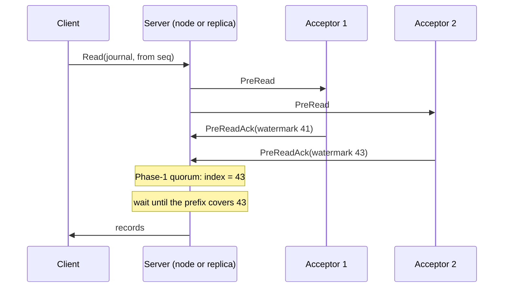

# Leaderless quorum reads

Group: Reads. Status: verified 2026-10-31.

A linearizable read that never touches the leader and never reads a clock. The reader asks a
**Phase-1** quorum of acceptors for their **vote watermarks** (the highest slot each voted in),
takes the maximum, and serves the read once its own applied prefix covers that index
([SRSM §3.4], after Paxos Quorum Reads). Every write acknowledged before the read began is then
visible to it. In paros every `Read` takes this path (`QuorumRead`, #143), on any node or
replica: there is no lease read and no read through the leader.

## 1. Problem

A Multi-Paxos leader linearizes reads too, so reads load the leader and every replica
([SRSM §3.4]: "the remaining bottlenecks after 1–3"). The usual ways out cost something:

- a read through the log costs a full Phase 2;
- a lease read on the leader trusts clocks (paros enforces no lease, `docs/architecture/02-data-plane.md`
  §2.3);
- a plain read from any replica can be stale.

Reads do not modify state, so they need not be ordered by the leader, and only one replica needs
to serve one ([SRSM §3.4]).

## 2. Model

- The Multi-Paxos model with flexible or grid quorums: every Phase-1 quorum meets every Phase-2
  quorum of the **same** configuration.
- A write is acknowledged only once it is chosen, so a Phase-2 quorum voted its slot.
- No clock assumption, for safety or for the read path's correctness.

## 3. Roles and state

| Role | State | Durable? |
|---|---|---|
| Acceptor | its vote watermark (`Acceptor::vote_watermark`: its last record, its last faulty slot, or its floor − 1) | derived from durable records |
| Reader (any node or replica) | one `QuorumRead` per open read: the row, the configuration, the answers so far; bounded by a TTL (`QuorumReads`) | no |
| Reader | the **read basis**: the configuration, ballot and fence of the last leadership it heard **win** (`ReadBasis`) | no |

## 4. Normal flow

1. A client's `Read` reaches a node or a replica. The server opens a quorum read
   (`ColocatedNode::quorum_read`, or `quorum_read_in` with a row; `ReplicaNode::quorum_read_in`).
2. It sends `PreRead` to a Phase-1 quorum's addressees: the whole membership under a majority,
   a flexible split or a partition grid (`acks < rows`), **one row** on a full-column grid
   (`phase1_addressees`).
3. Each acceptor answers `PreReadAck` with its vote watermark (`on_pre_read`).
4. When the answers form a Phase-1 quorum in that row (`has_phase1_quorum_in`), the read's index
   is `max(max watermark, the basis's fence)`.
5. Once the server's prefix covers that index (`Replica::covers`), the read is served from its
   journal fold (`Ready::read_states`, after `Ready::committed` in the same batch; on a replica,
   `ReplicaReady::read_states`).

## 5. Recovery flow

- **A row that never answers whole, a watermark never reached, a configuration that moves.** The
  read surfaces nothing and is dropped after the read window (`Limits::read_window`, at least
  `READ_TTL_TICKS`); the driver's timeout answers the
  client **unserved** (ambiguous), and the client asks another server.
- **A newer configuration.** A node abandons every open read when it learns one
  (`QuorumReads::abandon_superseded`): the row it asked need not meet the successor's columns.
- **A campaign in progress.** A server whose belief moved above its basis opens no read until the
  new leadership's beat arrives: "reads are unavailable during a campaign, never stale"
  (`quorum_read.rs` module doc).
- **A rebooted acceptor** on a matchmaker deployment answers no `PreRead` until it has heard what
  configuration is in force.
- **A floor ahead of the fold.** A server that jumped to a trim point but has not applied the
  `Truncate` answers unserved, never `Truncated` (02 §2.5).

## 6. Why it is safe

From the `quorum_read.rs` module doc: a write acknowledged before the read began was chosen by a
Phase-2 quorum `Q2` at slot `s`. The read's Phase-1 quorum `Q1` meets `Q2`
(`QuorumSystem::cross_intersects`; under a grid a row meets every column in one cell), so some
acceptor in `Q1` voted `s` and its watermark is at least `s`. The maximum is at least `s`, and the
server serves only after it applied `s`. That is the read half of linearizability; [SRSM §3.5]
proves the whole protocol linearizable by case analysis on pairs of operations.

The argument holds inside **one configuration**. Across a reconfiguration, a node that promised a
campaign's `Prepare` believes a configuration that may never win, and older configurations can
still hold slots its quorums never voted. So the basis comes only from a leadership that **won**,
with its fence: everything an earlier configuration chose sits at or below the fence (#260,
"option A").

## 7. Liveness

- A watermark raised by an accept that never decided makes the server wait for the next leader's
  gap fill; the read may expire ambiguous. That is a longer wait, never a stale answer.
- The read window is a tunable (`Limits::read_window`, at least `READ_TTL_TICKS` = 20 ticks). The
  sim floors the driver's `read_retry_ticks` at two round trips of the slowest link it keeps,
  because a shorter window is not winnable (PR #789 (fix main: three sim reds)).
- Reads stop during a campaign and resume with the new leadership's first beat.

## 8. Costs

- One Phase-1 round of watermarks per page: one round trip, plus the wait for the prefix
  (02 §2.5). In a multi-region cell that is one cross-region round trip.
- On a full-column grid, a read asks one row, so each acceptor answers `1 / rows` of the reads.
- Rows and columns are independent: more read capacity does not cost write throughput
  ([SRSM §3.4]).

## 9. In paros

| What | Where |
|---|---|
| The tally | `paros-core/src/quorum_read.rs`: `QuorumRead`, `QuorumReads` (`open`, `fold`, `serve`, `expire`, `abandon_superseded`), `ReadBasis` |
| The wiring on a node | `paros-core/src/node/quorum_reads.rs`: `quorum_read`, `quorum_read_in`, `on_pre_read`, `on_pre_read_ack`, `serve_quorum_reads`, `tick_quorum_reads` |
| The watermark | `paros-core/src/acceptor.rs`: `Acceptor::vote_watermark` |
| The cover check | `paros-core/src/replica.rs`: `Replica::covers` |
| On a replica | `paros-core/src/replica_node.rs`: `ReplicaNode::quorum_read_in` |
| The decision | `docs/architecture/02-data-plane.md` §2.5 |

**Sim gates and oracles** (`paros-sim/src/audit/node.rs` and `audit/state.rs`):

- `"quorum read: a read serves every slot chosen before it opened"`.
- `"quorum read: a node serves only once its prefix covers the row's watermark"`.
- `"quorum read: a node never reuses a read token"`.
- Outcomes: `"quorum read: a read is served by a node that is not the leader"`, `"quorum read: a
  read is served after a leader change"`, `"quorum read: the row's watermark lies past the
  server's prefix"`, `"grid: a quorum read is served by a row of a grid"`, `"replica: a quorum
  read is served by a replica"`.
- The client history is searched for a linearization of every `Read` against the journal's model
  (#205).

**Divergences from the sources:**

- [SRSM §3.4] has the client collect the watermarks and send `Read⟨x, i⟩` to one replica. In
  paros the server runs the pre-read on the client's behalf.
- [SRSM §3.4] reads from a replica. paros serves from any node (leader, follower, spare) or
  replica.
- An undecided slot under the watermark makes the server wait until it is decided or gap-filled
  (the `quorum_read.rs` module doc). How Paxos Quorum Reads treats that slot waits for its
  transcript (below).
- paros adds the read basis and its fence (#260); the papers assume one configuration.
- [SRSM §3.6]'s sequentially and eventually consistent reads are not in the core: the first is
  client-side watermark bookkeeping, the second a plain read from any replica.

## 10. Pitfalls

- **A read over a campaign's configuration (#260).** A leader under `{0,1,3}` with `q2 = 1` chose a
  `SetLeader` with its own vote, campaigned with `{0,2,3}` and died; an acceptor that promised the
  campaign served reads from a majority of the new configuration and missed the slot for a second
  (02 §2.5). Fixed by the read basis.
- **A read window shorter than the slowest round trip.** On a slow-link seed every read expired
  before its last answer. Witness: `replay-recipe 11132861827014470837
  1327731:15717124982357204208` on `5833bb3`; green after the floor (commit `d3d9f6a`).
- **Serving before the batch is reported.** A server that released its next apply page before it
  served the reads of the last one could serve slots not yet persisted (#550, replica-tier card).

## 11. Relatives

- [Replica tier](replica-tier.md): the servers that take read load off the acceptors.
- [Grid quorums](grid-quorums.md): a read addressed to one row.
- [Leadership fence and CheckQuorum](check-quorum.md): why paros needs no lease.
- [Flexible quorums](flexible-quorums.md): why a Phase-1 quorum meets every Phase-2 quorum.

## 12. Sources

- [SRSM] *Scaling Replicated State Machines with Compartmentalization*:
  `docs/references/papers/scaling-rsm-compartmentalization/transcript.md` §3.4 (leaderless reads,
  PQR), §3.5 (correctness), §3.6 (non-linearizable reads).
- frankenpaxos read batcher: `docs/references/frankenpaxos/04-compartmentalization.md` §5.
- To add: Charapko, Ailijiang, Demirbas, *Linearizable Quorum Reads in Paxos*, HotStorage 2019
  (<https://www.usenix.org/conference/hotstorage19/presentation/charapko>). No transcript yet:
  `usenix.org` is outside the network allowlist of the session that wrote this card. No claim
  in this card rests on it.

[SRSM §3.4]: ../../references/papers/scaling-rsm-compartmentalization/transcript.md
[SRSM §3.5]: ../../references/papers/scaling-rsm-compartmentalization/transcript.md
[SRSM §3.6]: ../../references/papers/scaling-rsm-compartmentalization/transcript.md
