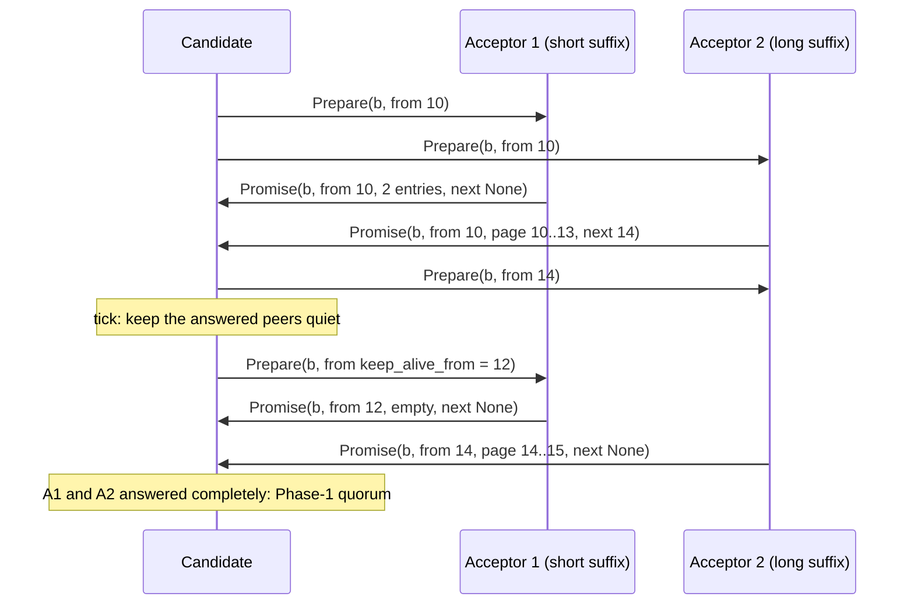

# Paging a campaign

Group: Leader. Status: written 2026-11-22, waits for a second reviewer.

A Paxos `Promise` carries the acceptor's whole accepted suffix from the asked slot, and that
suffix has no bound. paros sends it in **pages**: at most `Limits::promise_page` entries per
`Promise`, with a cursor (`next_from_slot`) for the next page. The candidate asks page after page
and counts an acceptor in its Phase-1 quorum only after its last page. While it pages, it keeps
the peers that already answered quiet with a cheap **keep-alive** `Prepare`
(`Election::keep_alive_from`) that they answer with an empty page.

## 1. Problem

In Phase 1 of Multi-Paxos, each acceptor reports every value it accepted at or above the
candidate's first slot ([PMMC §4.1], "first unknown slot"; [PML §4.2]). After a long run with a
slow leader change, or on an acceptor that lags in the apply walk, that suffix can hold many
entries. One `Promise` that carries all of them is an unbounded message: it can exceed what the
transport takes, it fills one link while the others wait, and it is lost and sent again as one
block.

Raft does not have this problem in its election: a vote carries no log, because a Raft candidate
is up to date already ([etcd-raft §3]: `raftLog.isUpToDate`, `log.go:442`). It has the same
problem in its replication, and it solves it with pages: a `MsgApp` carries at most
`MaxSizePerMsg` bytes, and the follower's answer is the cursor for the next page ([etcd-raft
§1, §3]). paros applies the same pattern to Phase 1.

Paging makes a second problem. A paging candidate talks to one slow peer for many round trips.
The peers that answered at once hear nothing more, their election clocks fire, and a rival
campaigns one ballot higher. The next candidate meets the same long suffix, and the cell can
elect no leader (#428 (paging livelock)). etcd-raft meets the same stall when its appends are
lost, and sends an **empty** append on each heartbeat answer to keep the exchange alive
([etcd-raft §4]).

## 2. Model

- The Multi-Paxos model of the [election](election.md) card: crash-recovery processes with
  durable storage, an asynchronous network that loses, duplicates and reorders messages.
- A page size is per process and never on the wire. A receiver checks a page against the
  ceiling (`PROMISE_BATCH`), never against the sender's size (`contract/limits.rs` module doc;
  the same split as etcd-raft's per-`Config` limits, [etcd-raft §1]).
- No clock in `paros-consensus`: the keep-alive goes on the leader's beat cadence of `tick()`
  (`HEARTBEAT_TICKS`).

## 3. Roles and state

| Role | State | Durable? |
|---|---|---|
| Acceptor | its promise and accepted records (as for every `Promise`) | yes |
| Acceptor | nothing for the page: each `Promise` page is computed from the asked slot (`Acceptor::promise_page`) | no |
| Candidate | per sender, the cursor it expects next (`promise_next`), and the senders that answered completely (`answered`) | no |
| Candidate | the merged suffix (`recovered`) and the faulty reports (`faulty_reports`) | no |
| Every process | its page size, `Limits::promise_page`, in `1..=PROMISE_BATCH` | configuration |

## 4. Normal flow

1. The candidate sends `Prepare(b, from_slot)` to its Phase-1 audience.
2. An acceptor promises `b` (a durable write when the promise rises) and answers with one page:
   the first `promise_page` entries of the slot-ordered union of its records and its faulty
   entries at or above `from_slot`, and `next_from_slot = Some(cursor)` if more remain
   (`Acceptor::promise_page`).
3. The candidate folds the page (`Proposer::fold_promise`). A page with a cursor folds as
   `PromiseFold::Continue(next)`: the candidate resets its election clock (a valid page is
   contact) and asks the same acceptor again from `next` (`request_promise_page`, a `Prepare` at
   the same ballot, which the acceptor answers with no durable write).
4. The last page (`next_from_slot = None`) folds as `PromiseFold::Answered`. Only then does the
   acceptor count toward the Phase-1 quorum (`Message::Promise` doc: "only then may the candidate
   count this acceptor in its Phase-1 quorum").
5. On every tick while the campaign pages, the candidate re-sends its `Prepare` to every peer
   that answered completely, from `keep_alive_from` (one past every slot it merged). Such a peer
   has nothing there, so it answers with an empty page, and its election clock resets
   (`ColocatedNode::keep_paging_promisers`).

## 5. Recovery flow

- **A lost page.** The candidate asks for the next page only when a page arrives, and the
  keep-alive goes only to the peers that answered completely. So a lost page or a lost request
  leaves its sender incomplete for the rest of the campaign; the candidate's election clock,
  which only a valid page resets, runs out, and the tick hands the node to `on_check_leader`
  for its next campaign. A page that arrives out of order is folded
  only at the cursor the candidate expects from that sender; any other page is `Ignored`
  (`Proposer::fold_promise` doc).
- **A restart of the acceptor.** Its pages are computed from its disk on each ask, so a restart
  between two pages changes nothing; it keeps its promise and its records.
- **A restart of the candidate.** The paging state is not durable. The candidate campaigns again
  at a higher ballot and pages from the start.
- **A leader's repair probe** pages the same way: a leader folds a late `Promise` page of its
  probe (`on_probe_promise`) and asks for the next one (probe "repair: a leader's probe pages a
  straggler's late Promise").

## 6. Why it is safe

Paging changes only **when** the candidate has the whole report, never what it does with it. The
P2c merge needs, from a Phase-1 quorum, every value each member accepted at or above the first
slot ([PMMC §2], the scout's `pvalues`; [election](election.md) §6). The candidate counts a
member only after its terminal page, and each page is folded only at the cursor that the last
page named, so the merged suffix of a counted member is its whole suffix, with no slot left out
and none counted twice. A page whose cursor, bounds or order are wrong is refused as wire input
(`promise_page_shape_valid`), never folded.

The keep-alive asks from `keep_alive_from`, which lies past every merged slot and at or past the
campaign's first slot (two assertions in `Election::keep_alive_from`). Its answer folds as
`Ignored`, because the tally refuses a second answer from a sender that answered completely. So a
keep-alive adds no entry to the merge and removes none.

## 7. Liveness

- A page always carries at least one entry while entries remain: `PROMISE_BATCH > 0` is a
  compile-time assertion, and `Limits::assert_valid` refuses a page of 0. Without that, "the
  continuation cursor would never advance" (`contract/limits.rs`). etcd-raft keeps the same
  rule in `limitSize`: "Always returns a non-empty slice if the input is non-empty"
  ([etcd-raft §2]).
- A valid page resets the candidate's election clock, so a long suffix does not make the
  campaign expire in the middle of a page.
- The keep-alive resets the election clocks of the peers that answered, so they do not start a
  rival campaign while the candidate pages one slow peer (#428). A campaign whose ballot fell
  below the node's own promise sends no keep-alive: it can no longer win.

## 8. Costs

- A suffix of `n` entries from one acceptor costs `⌈n / promise_page⌉` round trips, one after
  the other (pages are not pipelined).
- A keep-alive costs one `Prepare` and one empty `Promise` per answered peer per beat, and no
  disk write (the acceptor re-affirms the same ballot).
- A campaign that does not page sends nothing more: the plain path is unchanged.

## 9. In paros

| What | Where |
|---|---|
| The page size and its ceiling | `paros-consensus/src/contract/limits.rs`: `Limits::promise_page`, `PROMISE_BATCH`, `Limits::assert_valid` |
| The cursor on the wire | `paros-consensus/src/contract/message.rs`: `Message::Promise::next_from_slot` |
| The acceptor's page | `paros-consensus/src/acceptor.rs`: `Acceptor::promise_page`, `PromisePage` |
| The acceptor's answer | `paros-consensus/src/node/acceptor.rs` (a same-ballot continuation re-sends no write) |
| The fold and the cursor check | `paros-consensus/src/proposer/election.rs`: `Proposer::fold_promise`, `PromiseFold`; `paros-consensus/src/proposer.rs`: `promise_page_shape_valid` |
| Paging state and the keep-alive slot | `paros-consensus/src/proposer/election.rs`: `Election::paging`, `Election::keep_alive_from` |
| The next-page request and the keep-alive | `paros-consensus/src/node/election.rs`: `request_promise_page`, `ColocatedNode::keep_paging_promisers` (called from `ColocatedNode::tick`) |
| The model | `specs/tla/node/Node.tla`: the `Page(a, b, lo, hi)` action and the `Paged` constant; `specs/tla/multi-paxos/` names `Acceptor::promise_page` |

The rule is stated in the doc comments of `Election::keep_alive_from` and
`keep_paging_promisers`, and of `Message::Promise::next_from_slot`.

**Judges today:**

- Core probes, all reached in CI by `consensus-sim`'s coverage gate (`tests/coverage.rs`):
  "phase1: a promise page carries a continuation cursor", "phase1: a full promise page mixes
  readable and faulty entries", "phase1: a candidate pages a Promise suffix longer than one
  page", "phase1: a paging candidate re-sends its Prepare to the peers that answered" and
  "repair: a leader's probe pages a straggler's late Promise".
- `consensus-sim`: `Flavor::paged` puts every page at its floor (one entry), so the walks page
  every promise; the oracles `ONE_VALUE` and `LEARNED_CHOSEN` judge each step, and the node trace
  spec checks each page against `Page` in `Node.tla`.
- Unit tests: `promise_suffix_is_served_in_bounded_pages`,
  `a_partial_promise_page_does_not_count_toward_the_quorum` and
  `a_paging_campaign_keeps_its_promisers_quiet` (`src/node/tests/election.rs`),
  `promise_suffix_and_leader_recovery_are_paged` (`src/node/tests/bounds.rs`),
  `promise_pages_are_cursor_checked`, `a_promise_page_of_the_wrong_shape_is_refused` and
  `probe_promise_pages_are_cursor_checked` (`src/proposer/tests.rs`),
  `a_keep_alive_skips_a_promiser_outside_the_configurations` and
  `a_keep_alive_reaches_a_member_of_one_configuration_only` (`src/node/tests/matchmaking.rs`).

**Divergences from the sources:**

- etcd-raft pages by bytes (`MaxSizePerMsg`); paros pages by entries (`promise_page`).
- etcd-raft pages the log transfer from leader to follower, and the cursor is the leader's
  `pr.Next`. paros pages Phase 1, from acceptor to candidate, and the cursor travels in the page
  (`next_from_slot`).
- etcd-raft's empty append comes on each heartbeat answer. paros's keep-alive is a `Prepare` at
  the campaign's own ballot, sent on the beat cadence only while the campaign pages, and only to
  the members of the campaign's configurations (a pool node outside them is not asked).
- The papers ([PMMC], [PML]) describe a `Promise` as one message and do not page it.

## 10. Pitfalls

- **The paging livelock (#428).** Before the keep-alive, the peers that answered at once heard
  nothing while the candidate paged a long suffix; their clocks fired first, a rival campaigned
  one round higher, and the next candidate met the same suffix. The old sweep went red on
  "cluster converged after chaos" (a Phase 1 that needed all five nodes, one node alone holding
  an 18-slot suffix, a one-entry promise page) and was green with the rule
  (`keep_paging_promisers` doc).
- **A keep-alive from the first slot.** The first keep-alive asked from the campaign's first
  slot, so each answered peer sent its whole suffix again on every tick. On a slow link that
  starved the page the campaign still waited for: one acceptor answered 1,911 keep-alives with a
  28-entry page each, 196 MB on one link and 38 M simulated events (witness seed
  1245551733207877429 on `d813220`). Asking from `keep_alive_from` makes the answer an empty
  page (`Election::keep_alive_from` doc).
- **A keep-alive to a pool node outside the campaign.** Phase 1 reaches only the members of the
  campaign's configuration and its prior ones; a keep-alive to another pool node was a message
  the tally ignores (witness recipe `10352207508829728857 579175:6364853693681497294` on
  `5042e11`). The keep-alive now asks only that audience.
- **A partial page must not count.** A sender that owes a page has not answered; counting it
  would let the candidate merge a cut suffix and miss a value that could be chosen. The
  invariant is an assertion: "a paging sender has not answered completely" (`Election::paging`).
- The doc comment of `keep_paging_promisers` still opens with "same ballot, same first slot";
  the rule, and the rest of that comment, ask from `keep_alive_from`. Trust the code and the
  second paragraph.

## 11. Relatives

- [Election, P2c merge and gap fill](election.md): the Phase 1 that this card pages.
- [Pipelining and resend](pipelining-and-resend.md) and [catch-up](catch-up.md): the other paged
  transfers of the core (the re-send page, the catch-up and the apply walk).
- [Corrupted storage recovery](corrupted-storage-recovery.md): the faulty entries that share a
  page with the records, and the repair probe that pages too.
- [Matchmaking](matchmaking.md): the registry answer is paged the same way (`REGISTRY_PAGE`).

## 12. Sources

- [etcd-raft] etcd-raft message size limits and paged log transfer, at commit `c51f010`:
  `docs/references/etcd-raft/message-size-limits.md` §1 (the limits, `raft.go:189`), §2 (a page
  keeps one entry, `util.go:282`), §3 (one page, the answer is the next cursor,
  `raft.go:618`, `raft.go:1554`; a vote carries no log, `log.go:442`), §4 (an empty append keeps
  a stalled exchange alive, `raft.go:1571`), §5 (a paged scan, `log.go:472`).
- [PMMC] van Renesse, Altinbuken, *Paxos Made Moderately Complex*:
  `docs/references/papers/paxos-made-moderately-complex/transcript.md` §2 (the scout collects
  `pvalues`), §4.1 (state reduction, the first unknown slot).
- [PML] Chandra, Griesemer, Redstone, *Paxos Made Live*:
  `docs/references/papers/paxos-made-live/transcript.md` §4.2 (Multi-Paxos: one Phase 1 for many
  instances).

[PMMC §2]: ../../references/papers/paxos-made-moderately-complex/transcript.md
[PMMC §4.1]: ../../references/papers/paxos-made-moderately-complex/transcript.md
[PMMC]: ../../references/papers/paxos-made-moderately-complex/transcript.md
[PML §4.2]: ../../references/papers/paxos-made-live/transcript.md
[PML]: ../../references/papers/paxos-made-live/transcript.md
[etcd-raft §1]: ../../references/etcd-raft/message-size-limits.md
[etcd-raft §2]: ../../references/etcd-raft/message-size-limits.md
[etcd-raft §3]: ../../references/etcd-raft/message-size-limits.md
[etcd-raft §4]: ../../references/etcd-raft/message-size-limits.md
[etcd-raft §1, §3]: ../../references/etcd-raft/message-size-limits.md
