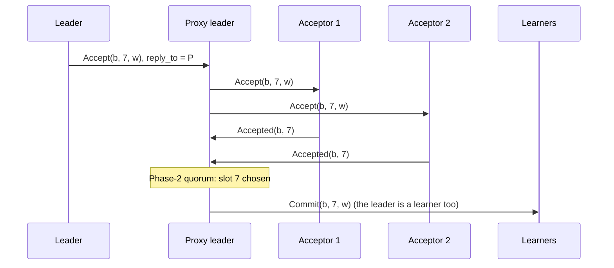

# Proxy leaders

Group: Compartmentalization. Status: verified 2026-10-31.

A Multi-Paxos leader has two jobs: it **sequences** commands into slots, and it **broadcasts**
each slot's `Accept`, folds the `Accepted`s and emits the `Commit`. Only the first job must be
serial. A **proxy leader** takes the second job: the leader sends one delegated `Accept` per
command to a proxy, and the proxy runs the Phase-2 fan-out and fold ([SRSM §3.1]). A proxy
contributes nothing to the decision, so moving it cannot break agreement. In paros the proxy is
`ProxyLeader` (#142): a `Rounds` plus routing, and no state that survives a crash.

## 1. Problem

To process one command the leader sends and receives at least `3f + 4` messages: the client's
message, `f + 1` `Phase2a`, `f + 1` `Phase2b`, `f + 1` to the replicas ([SRSM §3.1]). The
acceptors process two. The leader is the bottleneck, and a second leader is not allowed: there
is one sequencer.

## 2. Model

The Multi-Paxos model ([multi-paxos-log.md](multi-paxos-log.md) §2), plus a tier of proxies.
A proxy is neither an acceptor nor a replica; it votes on nothing and orders nothing. It can
crash at any time and reboots **empty**.

## 3. Roles and state

| Role | State | Durable? |
|---|---|---|
| Leader | a **delegated** `Round` per slot it handed out: the proxy, a re-delegation count, no votes | no |
| Proxy (`ProxyLeader`) | the highest ballot it was handed, that ballot's configuration, one open `Round` per delegated slot, the rounds it closed | no: no `HardState`, no `WriteOp`, no storage seam |
| Acceptor | unchanged: it accepts a proxy's `Accept` as a leader's | yes |

A proxy's tally is the same `Rounds` the `Proposer` embeds, and its decision is the same
predicate, `AcceptorConfig::has_phase2_quorum_in`: there is no second Phase-2 kernel (the
`proxy_leader.rs` module doc).

## 4. Normal flow

1. The leader allocates slot `s` and picks the proxy: `ProxyId(s % proxy_count)`
   (`ProxyId::of`), unless the driver names one (`Delegation::To`) or keeps the round on the
   leader (`Delegation::Colocated`).
2. It sends the proxy one `Accept` whose `reply_to` names the proxy and whose `leader` names
   itself. On a matchmaker deployment the delegation also carries `C_b`, because a proxy takes
   part in no Phase 1 and hears no beat.
3. The proxy opens the round and fans the same `Accept` out to the slot's addressees
   (`phase2_addressees`, one column on a grid), `reply_to` still naming itself.
4. Each acceptor answers `Accepted` to the proxy. The proxy folds only an addressee's answer, at
   the round's ballot and command.
5. A Phase-2 quorum decides the round: the proxy emits `Commit { from: Party::Proxy(me), .. }` to
   every learner and closes the round.

The leader now handles two messages per command, not `3f + 4` ([SRSM §3.1]).

## 5. Recovery flow

- **A `Nack`.** An acceptor promised above the round's ballot. The proxy closes the round and
  relays the `Nack` to the leader, which steps down by the ordinary rule. A proxy never decides
  what a refusal means.
- **A lost vote.** On each beat the proxy re-fans-out its open rounds
  (`ProxyLeader::resend_pending`). Skipping a beat is safe.
- **A proxy that crashed.** The leader re-delegates its open rounds on its own re-send
  (pipelining card). A duplicate delegation at an open round re-fans-out (P2b-idempotent).
- **A proxy that never answers.** After the driver's budget of re-delegations without a
  `Commit`, the leader takes the round back and runs it colocated
  (`ColocatedNode::take_back_delegated`). Liveness is the leader's, never a proxy's.
- **A round no acceptor answers** (a slot every acceptor compacted past). The proxy evicts it
  after `DriverTunables::proxy_round_resends` re-fan-outs (`ProxyLeader::expire_stale`).
  Eviction is not a decision: no `Commit`.
- **A new leadership.** A delegation at a higher ballot closes every round of a lower one; a
  delegation below the proxy's ballot is ignored.

## 6. Why it is safe

A chosen value is still exactly what a Phase-2 quorum durably accepted at one ballot; the proxy
only observes that quorum and announces it ([SRSM §3.1]; frankenpaxos §3(b): it adopts no
round). Every choice around it is safe:

- which proxy runs a round, or the leader itself: two fan-outs of one `(slot, ballot, command)`
  are P2b-idempotent, so two verdicts can only agree (the `Delegation` doc);
- closing, refusing or evicting a round: it only stops this proxy folding it;
- the round is judged over the configuration it was opened against, as a leader's is.

The sans-IO model checker beside it (`paros-core/src/models/proxy.rs`) runs real `ColocatedNode`s
and `ProxyLeader`s over a lossy, reordering, duplicating scheduler, with proxies and nodes
crashing and a leader handed off mid-round. After every step it asserts at most one value per
slot, and that every proxy `Commit` is backed by a Phase-2 quorum of **durable** accepts at one
ballot. "It bites": a proxy that commits one `Accepted` short is red on the first seed.

## 7. Liveness

- Proxies are embarrassingly parallel: add them until they are not the bottleneck ([SRSM §3.1]).
- A dead proxy costs a take-back, never a stuck slot.
- More machines shorten the expected time to `f` failures ([SRSM §3.1]); a proxy's failure costs
  only latency, because the leader takes its rounds back.

## 8. Costs

- One extra message delay per command: leader → proxy → acceptors → proxy → learners.
- The leader's load drops from `3f + 4` to 2 messages per command ([SRSM §3.1]).
- In the paper's evaluation, Compartmentalized MultiPaxos reached about 150,000 commands/s
  unbatched against about 25,000 for MultiPaxos, with 10 proxy leaders ([SRSM §8.1]).

## 9. In paros

| What | Where |
|---|---|
| The proxy's state machine | `paros-core/src/proxy_leader.rs`: `ProxyLeader`, `step`, `resend_pending`, `expire_stale`, `ready`, `delegator` |
| The leader's delegation | `paros-core/src/node.rs`: `Delegation`, `ColocatedNode::propose_in`; `paros-core/src/node/policy.rs`: `take_back_delegated` |
| The proxy for a slot | `paros-core/src/membership/ids.rs`: `ProxyId`, `ProxyId::of` |
| The model checker | `paros-core/src/models/proxy.rs` |
| The driver | `paros-roles/src/proxy_leader.rs`: `run_proxy`; a machine runs the proxy of each `Role::ProxyLeader` booking the registry holds for it (PR #775 (machine proxy leaders), #765) |

**Sim gates and oracles** (`paros-sim/src/audit/state.rs`):

- `"proxy: a Commit a proxy emits is backed by a durable Phase-2 quorum at one ballot"`.
- `"proxy: a proxy decides the command it was delegated"`.
- `"proxy: a slot is decided through a proxy leader"`, `"proxy: a leader takes a delegated round
  back"`.
- Driver sites (`paros-roles/src/node/draws.rs`, `paros-roles/src/proxy_leader.rs`): `"proxy: the
  driver overrides a round's proxy"`, `"proxy: the driver runs a round
  colocated on a proxied deployment"`, `"proxy: a proxy skips a re-fan-out beat"`.
- The stalled-proxy scenario: every proxy drops the acceptors' answers for the chaos window, and a
  leader that holds delegated rounds resigns and campaigns again (commit `89c223c`).

**Divergences from the sources:**

- [SRSM §3.1] sends each `Phase2a` to a randomly selected proxy. paros uses `slot % proxy_count`,
  because the core has no RNG; the driver may override it.
- frankenpaxos's proxy sends to a thrifty `f + 1` subset. paros's proxy addresses the whole
  column or membership.
- On plain Multi-Paxos the proxy count is zero, and the wire carries exactly the plain
  deployment's messages.

## 10. Pitfalls

- **A round of a dead leadership.** Before the rule "the highest ballot handed is the leadership
  it works for", a round of a superseded leadership stayed open at a proxy for ever (model
  checker, seed 20 of the first run; the `proxy_leader.rs` module doc).
- **A round no `Commit` reaches.** A proxy is not a learner, so a round the leader took back and
  decided itself stayed open until the beat re-sent it (model checker, seeds 20 and 87).
- **A round re-fanned-out for ever.** A slot every acceptor compacted past is never answered.
  `expire_stale` bounds the retention.
- **Mutation survivors.** `Round::column -> None`, `Rounds::close_below -> vec![]` and
  `Rounds::stalled -> vec![]` survived the mutation hunt until the stalled-proxy scenario (#341,
  commit `89c223c`).

## 11. Relatives

- [Pipelining and resend](pipelining-and-resend.md): re-delegation and take-back.
- [Grid quorums](grid-quorums.md): a proxy fans out to one column.
- [Batchers and unbatchers](batchers.md): the other leader bottleneck.
- [Leader handoff](leader-handoff.md): a successor re-delegates inherited rounds.

## 12. Sources

- [SRSM] Whittaker et al., *Scaling Replicated State Machines with Compartmentalization*:
  `docs/references/papers/scaling-rsm-compartmentalization/transcript.md` §3.1
  (Compartmentalization 1), §8.1 (latency and throughput).
- frankenpaxos: `docs/references/frankenpaxos/04-compartmentalization.md` §3 (the `ProxyLeader`,
  the keystone).

[SRSM §3.1]: ../../references/papers/scaling-rsm-compartmentalization/transcript.md
[SRSM §8.1]: ../../references/papers/scaling-rsm-compartmentalization/transcript.md
