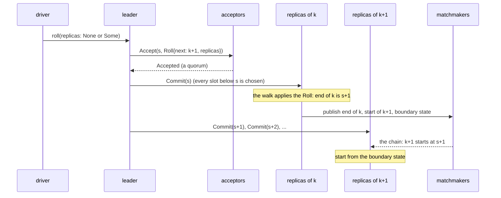

# Segments in the core

Group: On the log. Status: written 2026-11-25 (design; not built).

A **segment** is a range of slots of one Multi-Paxos log and the replicas that keep that range.
A segment ends at a decided command, the `Roll`. The acceptors do not change at the boundary, so
nothing must be sealed in the sense of Delos: every node only has to agree on the last slot of
the segment, and a log decides one value for each slot ([PMS §3]). The design is §4.7 of
`docs/architecture/` (`04-7-segments.md`), and its model is `specs/tla/segment-roll/`.

## 1. Problem

A log that lives for ever on its acceptors grows for ever. The compaction floor (the
[truncation](truncation.md) card) drops a prefix, but only when the tenant truncates. To move
old slots off the acceptors, to give a range of the log other replicas, or later to put a range
in an object store, the log needs a boundary that every node agrees on. Delos does this with a
chain of ranges, each range its own log, and a seal of the last range before a new one starts
([Delos §3.1], [Delos §3.2]). paros wants the boundary without a second consensus beside the core.

## 2. Model

The Multi-Paxos model: asynchronous messages, crash and restart, a chosen slot never changes. A
leader can pipeline, so a slot can be chosen before the slots below it. One grid of acceptors
votes on every slot of every segment; a grid change is a round change and cuts no segment
([MMP §4.2]).

## 3. Roles and state

| Role | State | Durable? |
|---|---|---|
| Leader | its tail segment as it believes it: the fold of its chosen prefix and of the values that its Phase 1 recovered | no: rebuilt at each election |
| Acceptor | its votes, as today. Acceptors stay learners (D2 of §4.7.2) | yes |
| Replica of a segment | the chosen prefix of its segment, from the boundary state at its start to its end | yes |
| Matchmakers | the chain: one record for each segment (start, end, replicas, boundary state, state), an add-only map beside `history` ([MMP §3.2]) | yes |

## 4. Normal flow

The `Roll` is an ordinary value of the log. A `Commit` of slot `t` goes to the replicas of the
segment of `t`, and it leaves only once the leader knows that every slot below `t` is chosen
(R4d), so its route is a fold of a chosen prefix.

## 5. Recovery flow

A new leader takes its tail segment from its own chosen prefix and from the values that its
Phase 1 recovered, in slot order (R4c), never from the chain alone: the chain is behind the log
by up to one roll. A `Roll` that a minority voted is recovered or lost like any other value: if
Phase 1 forces it, it is proposed again; if not, the slot gets the gap fill `Noop` and the
`Roll` never happened. A replica that restarts reads its start from the chain and catches up.

## 6. Why it is safe

Paxos gives one value for each slot. A replica acts on its contiguous chosen prefix only (R3),
so every replica of segment `k` applies the same first valid `Roll` and sees the same end. So no
two ends exist for one segment (`OneEnd` of `specs/tla/segment-roll/`), and a replica applies only
the slots of its own segment (`ReplicaTrue`). Every value that the chain holds is a function of
the chosen log, so two writers never write two values, and a partial write is already true
(`ChainTrue`; the same argument as the registry of [MMP §3.2]).

Routing is not safety. A leader can believe the wrong segment for a slot when a later ballot
chooses, below that slot, the `Roll` of an older ballot that the leader's Phase 1 did not see.
The model found it with three ballots. The `Commit` waits for the chosen prefix (R4d), so the
belief that it carries is the true segment.

## 7. Liveness

A roll needs a leader and a Phase-2 quorum of the grid, like any write. A replica of `k + 1`
needs the boundary state, from the chain or from a replica of `k`. A `Commit` waits for the
chosen prefix below it, so one slot that is slow to be chosen holds back the `Commit`s above
it; the replicas apply in slot order anyway.

## 8. Costs

One log entry for each roll, and one write of the chain record for each segment, by any node
whose walk applied the `Roll`. No extra round trip on the write path. A `Roll` with no new
location keeps the replicas of the segment that it ends (D4 of §4.7.2), so the next segment
starts at once.

## 9. In paros

Not built yet. The order of work is §6 of
[`docs/archive/journal-design-a/prompt.md`](../../archive/journal-design-a/prompt.md): step 1 is
the model `specs/tla/segment-roll/` (PR #1540 (segment-roll)), step 3 the cut in
`paros-consensus` (`Control::Roll`, a segment cursor in `replica.rs`, `roll()` on the node).

Divergences from the sources (each a departure of §4.7.4, with its check):

- The `Roll` is a new command (departure 1). [PMS §3] decides a configuration through the state
  machine, with a window of `α` commands; Matchmaker Paxos calls this horizontal
  reconfiguration and lists `α` as hard to tune, among other drawbacks ([MMP], "vs. Horizontal
  MultiPaxos"). The `Roll` changes the learners of a range, not the acceptors, so it needs no
  `α`: a `Roll` at `s` ends its segment at `s + 1`.
- [Stoppable] decides the end in the log too, but it stops the instance: after a stop at `i`, a
  leader sends nothing above `i`, and a new leader voids a stop at `i` when an instance above `i`
  has a vote at a ballot at least as high as the stop's ([Stoppable §3], `sval2a`).
  The `Roll` stops nothing: the same log goes on. The plan's pause (a leader sends
  nothing above its own `Roll` until it is chosen) was the rule of [Stoppable §3] for one
  ballot; with R4d routing does not need it, and paros has no pause (Pierre, 2026-11-25, §4.7.3).
- The floor at `Held` (R7) uses Scenario 3 of Matchmaker Paxos for the compaction floor
  (departure 2), to check in step 6.

## 10. Pitfalls

- **The chain is behind the log.** A leader that takes its tail segment from the chain routes to
  an old segment (`route_commit_base_chain`, `base_chain`).
- **A routed `Commit` before the prefix is chosen** strays with three ballots (`route_propose`),
  although the pause and the hole fill hold. Found by TLC on 2026-11-24, against the prediction
  of the plan.
- **Acting on a vote.** A replica that applies a voted `Roll` can see a second end
  (`act_vote`).

## 11. Relatives

- [Replica tier](replica-tier.md): the replicas of a segment are replicas in this sense.
- [Truncation](truncation.md): the floor and the trim-point jump that a replica starts from.
- [Matchmaking](matchmaking.md): the matchmakers that hold the chain.
- [Leader handoff](leader-handoff.md): the successor keeps the ballot; with R4d it needs no rule
  for segments.
- [Election](election.md): the gap fill `Noop` (R4b).

## 12. Sources

- [PMS] *Paxos Made Simple*: `docs/references/papers/paxos-made-simple/transcript.md` §3
  (pipelining, the gap, reconfiguration through the state machine with `α`).
- [MMP] *Matchmaker Paxos*: `docs/references/papers/matchmaker-paxos/transcript.md` §3.2 (the
  registry), §4.2 (a configuration belongs to a round), "vs. Horizontal MultiPaxos" (`α`).
- [Delos] *Virtual Consensus in Delos*: `docs/references/papers/delos-virtual-consensus/transcript.md`
  §3.1 (the chain), §3.2 (seal, install, refetch, the "sealed" error).
- [Stoppable] *Stoppable Paxos*: `docs/references/papers/stoppable-paxos/transcript.md` §3 (no
  2a above a stop, voiding).
- [SRSM] *Scaling Replicated State Machines with Compartmentalization*:
  `docs/references/papers/scaling-rsm-compartmentalization/transcript.md` §3.3 (more replicas).

[PMS §3]: ../../references/papers/paxos-made-simple/transcript.md
[MMP]: ../../references/papers/matchmaker-paxos/transcript.md
[MMP §3.2]: ../../references/papers/matchmaker-paxos/transcript.md
[MMP §4.2]: ../../references/papers/matchmaker-paxos/transcript.md
[Delos §3.1]: ../../references/papers/delos-virtual-consensus/transcript.md
[Delos §3.2]: ../../references/papers/delos-virtual-consensus/transcript.md
[Stoppable]: ../../references/papers/stoppable-paxos/transcript.md
[Stoppable §3]: ../../references/papers/stoppable-paxos/transcript.md
