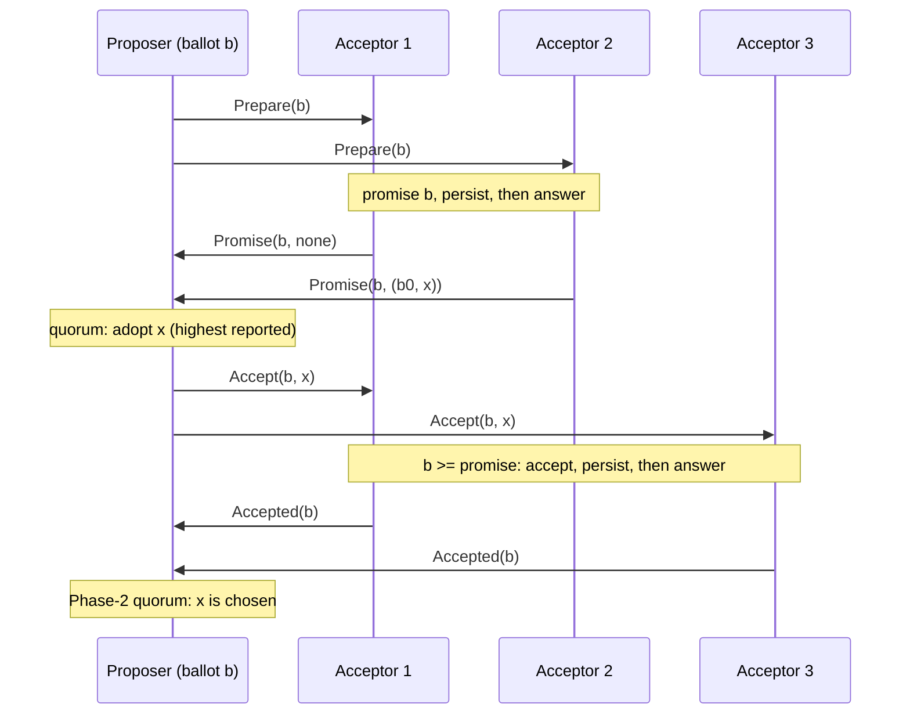

# Single-decree Paxos

Group: Kernel. Status: verified 2026-10-31.

Single-decree Paxos chooses **one value** among the values that proposers propose, with no
bound on message delay and with crashes. Every other card builds on it. paros runs it in two
forms: inside the Multi-Paxos log (one instance per slot), and alone as `Decree<Id, V>` for a
one-shot decision (the matchmaker handover and `cell init`).

## 1. Problem

Several processes propose values. They must agree on one ([PMS §2.1]):

- only a proposed value may be chosen;
- only a single value is chosen;
- a process never learns that a value is chosen unless it is.

One acceptor is not enough: its crash blocks progress for ever. With several acceptors, a value
is chosen when a quorum accepts it. The hard part is that an acceptor must sometimes accept a
second proposal, and the second one must not choose a different value ([PMS §2.2]).

## 2. Model

- Asynchronous and non-Byzantine ([PMS §2.1]). Processes run at any speed, stop, and restart.
- Messages can be lost, delayed and duplicated, but not corrupted. (paros's storage faults
  break the "stable storage" half of this model; the corrupted-storage card (planned) covers them.)
- Each acceptor has **stable storage** that survives a restart.
- No clock is needed for safety. Progress needs a single proposer for long enough
  ([PMS §2.4]).

## 3. Roles and state

| Role | State | Durable? |
|---|---|---|
| Acceptor | the highest ballot it promised | yes, before it answers |
| Acceptor | the highest-ballot proposal it accepted: `(Ballot, V)` | yes, before it answers |
| Proposer | its ballot, the promise tally, the value it will propose | no |
| Learner | the accept tally, then the chosen value | no (the chosen value can be learned again) |

[PMS §2.2] reduces an acceptor to exactly these two durable facts. In paros the acceptor is
`Acceptor<V>` (`paros-core/src/acceptor.rs`): `promised`, the per-slot `records`, and the
compaction floor. A decree is the same acceptor over the one slot `DECREE_SLOT`.

## 4. Normal flow

1. **Phase 1a.** The proposer picks a ballot `b` it never used, and sends `Prepare(b)`.
2. **Phase 1b.** An acceptor whose promise is below `b` raises it to `b`, writes it, and
   answers with the highest-ballot proposal it accepted, if any (`Acceptor::prepare`). An
   acceptor whose promise is above `b` refuses (`PrepareOutcome::Refused`, a `Nack`).
3. **Phase 2a.** With promises from a Phase-1 quorum, the proposer picks the value of the
   highest-ballot proposal reported, or its own value if none (`Decree::on_promise`, P2c).
4. **Phase 2b.** An acceptor accepts `(b, v)` if `b` is at or above its promise
   (`Acceptor::admit`), writes it, and answers `Accepted`.
5. **Learn.** With accepts from a Phase-2 quorum, `v` is chosen (`Decree::on_accepted` returns
   `AcceptFold::Chosen`).

## 5. Recovery flow

- **An acceptor crashes and restarts.** It reads back its promise and its accepted proposal
  and continues. It never answers below what it wrote ([PMS §2.5]: an acceptor records its
  answer before it sends it).
- **The proposer crashes.** Another proposer starts at a higher ballot. Phase 1 finds any value
  that could be chosen, so the new proposer re-proposes it.
- **The proposer is preempted.** A `Nack` names the higher promise. The proposer may retry
  strictly above it. `Decree::on_nack` keeps the highest refusal as the floor for the retry,
  because the caller owns the next ballot (the `decree.rs` module doc: the one place a decree
  differs from a log).

## 6. Why it is safe

The proof chain of [PMS §2.2]: **P2** (a chosen value binds every higher chosen proposal) ⇐
**P2a** (it binds every higher accepted proposal) ⇐ **P2b** (it binds every higher issued
proposal) ⇐ **P2c**: for a proposal `(n, v)` there is a quorum `S` such that either no acceptor
in `S` accepted below `n`, or `v` is the value of the highest-numbered proposal below `n`
accepted in `S`.

Phase 1 builds `S` and the promise stops `S` from accepting below `n` later. A value chosen at
`n0 < n` was accepted by a Phase-2 quorum; that quorum meets `S`, so `S` reports a proposal at
`n0` or higher, and by induction its value is `v`.

[GDC §3–§4] gives the same argument with write-once registers: "Phase 1 implements Rule 4;
phase 2 implements Rule 1". Phase 1 learns, for each earlier round, whether it may still
decide a value or decides nothing. It also shows
that only the Phase-1 quorum of round `r` must meet the Phase-2 quorums of the rounds below
`r` ([GDC §4.1]), which is Flexible Paxos.

Two more facts the argument needs, both in paros as hard asserts:

- **One ballot, one value.** Ballots are `(round, node)` pairs, so two proposers never share
  one. `Decree::on_promise` panics if two reports carry different values at one ballot.
- **A promise never goes down.** `Acceptor::set_promise` asserts it, across the node's whole
  life.

## 7. Liveness

Two proposers can preempt each other for ever ([PMS §2.4]). FLP says a fault-tolerant
consensus cannot guarantee termination in an asynchronous model; the fix is one distinguished
proposer, chosen with randomness or real time. A `Decree` in paros has no clock of its own:
its caller drives the retries (the matchmaker reconfigurer, or the machine that received
`cell init`).

## 8. Costs

- Two round trips (four message delays) from the proposer: Phase 1 and Phase 2.
- `2n` messages per phase for `n` acceptors.
- Two durable writes per acceptor (promise, accept).
- Quorums: any Phase-1 quorum must meet any Phase-2 quorum. With majorities that is
  `⌊n/2⌋ + 1` each.

## 9. In paros

| What | Where |
|---|---|
| The acceptor (both phases, the durable writes) | `paros-core/src/acceptor.rs`: `Acceptor::prepare`, `promise_page`, `admit`, `set_promise`, `record_accepted`, `PrepareOutcome`, `AcceptOutcome` |
| The decree (a one-slot proposer) | `paros-core/src/decree.rs`: `Decree`, `DECREE_SLOT`, `on_promise`, `on_accepted`, `on_nack`, `DecreePromise`, `AcceptFold` |
| The ballot | `paros-core/src/types.rs`: `Ballot { round, node }` |
| The durable writes | `paros-core/src/contract/write.rs`: `AcceptorWrite::SetPromise`, `AcceptorWrite::AppendAccepted` |
| Decree users | `paros-core/src/matchmaker/reconfigurer.rs` (the matchmaker handover, `SuccessorDecree`); `paros-machine` (`cell init`, #277) |

The rule is stated in the module docs of `acceptor.rs` (the acceptor knows nothing but its
votes) and `decree.rs` (no separate kernel: a decree is the `Proposer` over one slot).

**Sim gates and oracles:**

- `"a node's promised ballot never decreases"` (`paros-sim/src/audit/state.rs`) and
  `"a node's accepted ballot never exceeds its promised ballot"` (`audit/node.rs`).
- `"a sent Promise carries a durably promised ballot"` (`audit/node.rs`).
- `"at most one command is ever accepted for one (slot, ballot)"` and
  `"a durable accept quorum never decides two values for a slot"` (`audit/state.rs`).
- For the handover decree: `"generation: one value is voted per decree ballot"`
  (`audit/matchmaking.rs`).
- Unit tests: `a_lone_proposal_is_chosen_by_a_quorum`,
  `a_later_proposal_adopts_the_highest_prior_vote`,
  `a_nack_preempts_and_names_the_promise_to_beat` (`paros-core/src/decree/tests.rs`).

**Divergences from the sources:**

- [PMS §2.2] uses majorities. paros asks every quorum question through `AcceptorConfig`
  (`has_phase1_quorum`, `has_phase2_quorum`), so a log can run flexible or grid quorums. The
  matchmaker handover's decree uses majorities only (`decree.rs` module doc).
- [PMS §2.5] draws proposal numbers from disjoint sets. paros puts the node id in the ballot.
- `cell init` draws a fresh random ballot above its own durable promise, so one ballot never
  carries two plans (commit `fcbcc62`).

## 10. Pitfalls

- **Answer only after the write.** A `Promise` or `Accepted` sent before its write is durable
  lets a crash undo a vote. See the persist-before-send card.
- **Agreement of a majority's most recent votes is not "chosen".** [PMMC §4.1]: "do *not*
  conclude a value is chosen merely because a majority's *most-recent* pvalues agree — that's
  wrong." only a Phase-2 quorum at **one** ballot chooses.
- **A decree keeps its refusal.** The log drops a refusing acceptor's promise and lets an
  election move on; a decree's retry must clear the highest refusal, so `on_nack` keeps it
  (`decree.rs` module doc). Losing it re-opens below a promise that will refuse again.

## 11. Relatives

- [Multi-Paxos log and stable leader](multi-paxos-log.md): one instance per slot, one Phase 1
  for all of them.
- [Persist before send](persist-before-send.md): the durability half of the safety argument.
- [Election, P2c merge and gap fill](election.md): P2c over a whole log suffix.
- [Flexible quorums](flexible-quorums.md): why Phase-1 and Phase-2 quorums need only meet each
  other.
- Matchmaker generations and handover (planned): the main user of `Decree`.

## 12. Sources

- [PMS] Lamport, *Paxos Made Simple*: `docs/references/papers/paxos-made-simple/transcript.md`
  §2.1 (problem and model), §2.2 (P1, P2, P2a–P2c, the two phases), §2.4 (progress, FLP),
  §2.5 (stable storage, disjoint proposal numbers).
- [GDC] Howard, Mortier, *A Generalised Solution to Distributed Consensus*:
  `docs/references/papers/generalised-distributed-consensus/transcript.md` §3 (the four rules),
  §4 (Paxos as an instance), §4.1 (weakened quorum intersection).
- [PMMC] *Paxos Made Moderately Complex*:
  `docs/references/papers/paxos-made-moderately-complex/transcript.md` §4.1 (the warning about a
  majority's most recent pvalues).
- frankenpaxos single-decree analysis: `docs/references/frankenpaxos/02-single-decree-paxos.md`.

[PMS §2.1]: ../../references/papers/paxos-made-simple/transcript.md
[PMS §2.2]: ../../references/papers/paxos-made-simple/transcript.md
[PMS §2.4]: ../../references/papers/paxos-made-simple/transcript.md
[PMS §2.5]: ../../references/papers/paxos-made-simple/transcript.md
[GDC §3–§4]: ../../references/papers/generalised-distributed-consensus/transcript.md
[GDC §4.1]: ../../references/papers/generalised-distributed-consensus/transcript.md
[PMMC §4.1]: ../../references/papers/paxos-made-moderately-complex/transcript.md
