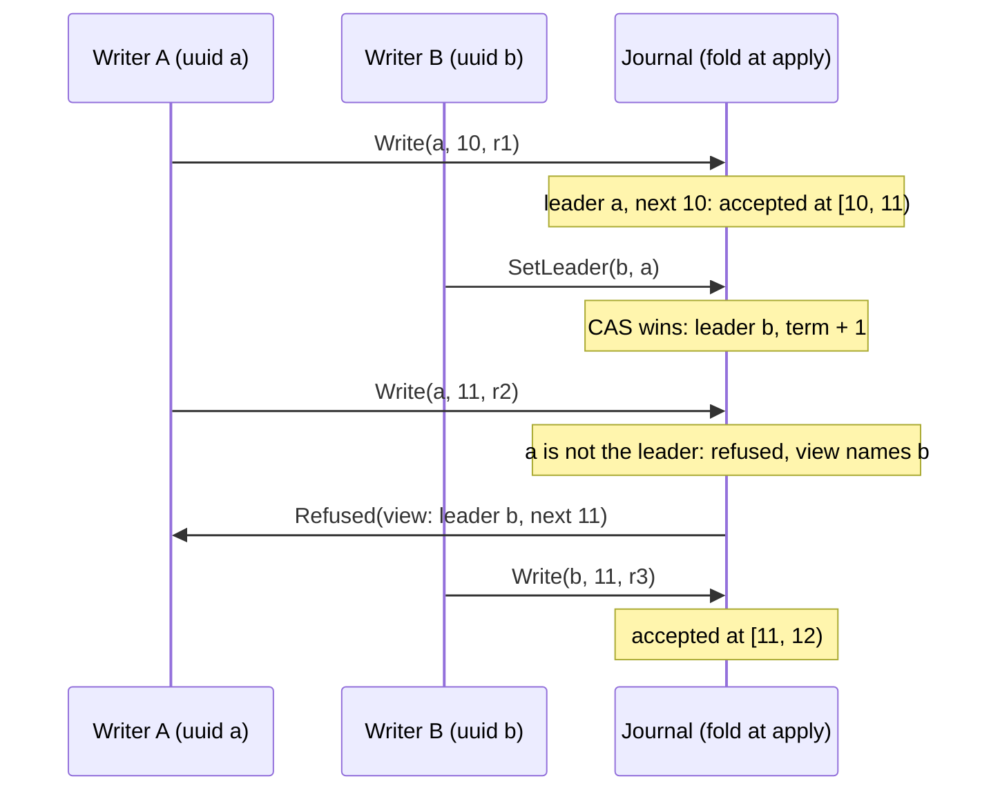

# Writer fence: the leader uuid, judged at apply

Group: On the log. Status: verified 2026-10-31.

Paxos decides **what** is in the log. It does not decide **who** may write: a client that lost
its leadership can still send a write, and Paxos will happily choose it. A single-writer journal
fences its writers with a **leader uuid**. `SetLeader(new, old)` is a compare-and-set recorded in
the log, and every `Write` and `Truncate` carries the uuid. A small state machine judges each call
**at apply**, in slot order, on every node alike: a call under a superseded uuid is refused in
place. The Paxos ballot fences machines; the leader uuid fences clients. The two never mix.

## 1. Problem

- Redis-style failover lets an isolated primary keep serving after a replica was promoted
  ([MemoryDB §4.1]): two writers at once.
- [PML §5.3]: a request may reach the master, which then loses (and possibly regains) mastership
  before the request updates the database. Chubby aborts a request if mastership changed, with a
  global **epoch number**: "all DB operations are made conditional on it".
- A lease-based fence ([MemoryDB §4.1.3]) depends on clocks. paros enforces no lease
  (`docs/architecture/02-data-plane.md` §2.3).

## 2. Model

- The Multi-Paxos log ([multi-paxos-log.md](multi-paxos-log.md) §2). A decided slot is applied by
  every node in slot order.
- Clients draw a fresh 128-bit uuid per leadership term. The journal trusts them to: a uuid named
  again wins again (decided on 2026-10-09, #241 (leader uuid fence)).
- Who becomes the leader is decided outside the journal, by an election. The journal gives
  safety to writers; the election gives liveness (02-data-plane.md §2.3).

## 3. Roles and state

| Role | State | Durable? |
|---|---|---|
| Journal fold (`JournalState`) | the current leader uuid, a hidden term, `next_seq`, `first_seq` | refolded from the log; sealed when compaction drops its slots, carried by a trim-point jump |
| Writer (`paros::client::Writer`, `Pipeline`) | its uuid for the term, the tail it knows | no |

A client sees the `JournalView`: the same scalars without the term. Only an operator's `Inspect`
shows the term.

## 4. Normal flow

1. A writer claims the journal: `SetLeader(new_uuid, old_uuid)`. It wins iff `old_uuid` is the
   current leader (unset on a fresh journal); the term rises by one. The answer is the view after
   it, so the writer continues at `next_seq`. It is refused when `new_uuid` already leads or is
   the unset uuid; the refusal (`Outcome::LeaderRefused`) names the current leader.
2. The writer sends `Write(uuid, expected_seq, batch)`. It is accepted iff `uuid` is the current
   leader, `expected_seq == next_seq` and the batch is not empty; the batch then occupies `[seq, seq
   + n)`.
3. A retry below `next_seq` that is **exactly** the write accepted there is an idempotent ack
   (`Outcome::Duplicate`). Anything else is refused, and below `first_seq` it is `Truncated`.
4. `Truncate(uuid, up_to_seq)` is fenced the same way ([truncation](truncation.md)).

## 5. Recovery flow

- **A superseded writer.** Its refusal names the current leader uuid and `next_seq`, so it learns
  at once that it lost. It stops writing (`"client: a superseded writer stops writing"`,
  `paros-sim/src/workload.rs`).
- **An ambiguous write.** The client reads back before any identical re-send (`Client::resolve`):
  a position below the floor is `Truncated`; a tail short of the position under another leader
  proves it not written; a page that holds exactly the batch at its position, ending at the tail,
  while the uuid still leads, at or above `Writer::led_from`, proves it written (#564 (client
  read-back settles a write)). A writer that rolled back behind writes whose fate it never learned
  settles by an identical re-send instead (02-data-plane.md §2.2).
- **A pipelined burst after a claim.** Every write still in flight under the old uuid is refused at
  apply. The design allows a leader to refuse them earlier from its own fold
  (02-data-plane.md §2.2); paros's driver does not do this, and the apply-time check is the
  safety.

## 6. Why it is safe

- **Judged at apply, in slot order, everywhere.** Every node folds the same decided slots in the
  same order, so every node reaches the same verdict for every call. A refusal consumes a slot and
  no position, so positions stay dense.
- **The compare-and-set orders the writers.** A `SetLeader` is itself a decided log entry. Every
  call after it in the log sees the new uuid; every call before it saw the old one. There is no
  window where two uuids are current.
- **The log is the deduplication table.** A retry is an ack only if it is byte-identical to the
  write at that position, so a re-send can never write twice, and there is no session ledger to
  expire.
- **No clock.** The fence holds whatever the clocks do; MemoryDB's lease and self-demotion are
  not implemented in the journal (02-data-plane.md §2.3).

## 7. Liveness

- A claim needs one slot. A writer that keeps losing the compare-and-set is an election problem,
  outside the journal.
- A writer that reinstates a uuid it led with before wins again. Only its own in-flight writes
  under that uuid are at stake, and the sim proves the guarantees hold through it
  (`reinstate_pct`).

## 8. Costs

- 16 bytes per write and per truncate.
- One slot per leadership change.
- No lease renewal traffic: [MemoryDB §4.1.3]'s leader appends lease renewals to the log; paros's
  writer does not.

## 9. In paros

| What | Where |
|---|---|
| The state machine | `paros-core/src/journal/state.rs`: `JournalState`, `JournalView`, `Outcome`, `WriterMode` |
| The fold at apply | `paros-core/src/replica.rs` |
| The writer | `paros-client/src/writer.rs`: `Writer`; `paros-client/src/pipeline.rs`: `Pipeline` |
| The decision | `docs/architecture/02-data-plane.md` §2.2–§2.4 |

**Sim gates and oracles:**

- The client's own history (`ClientHistory`, `paros-sim/src/audit/client.rs`) is searched for a
  linearization against the sequential model in `audit/linearizability.rs`.
- Every node's verdicts are folded by `audit/journal_model.rs`: `"journal: a SetLeader wins only
  over the leader in force"`.
- `"created: a superseded writer's write is never written"` (`workload/fleet/created.rs`).
- `"chain: a superseded writer reinstates its old uuid"` and `"chain: a reinstated uuid leads
  again"` (`workload.rs`); `"journal: a claim fences the rest of an owner's burst"`.
- `"client: a read-back alone proves an ambiguous write fenced"` and `"client: a read-back alone
  proves an ambiguous write written"` (`workload/write.rs`).
- `"election: a leader uuid leads one term"` (`audit/installs.rs`).

**Divergences from the sources:**

- [MemoryDB §4.1.1] makes each append name the entry it follows. paros fences by the leader uuid
  and the expected position, judged after Paxos chose the slot, not by the log service before.
- [MemoryDB §4.1.3] adds leases for leader singularity. paros enforces no lease: a leader serves
  nothing it did not read back from the journal (02-data-plane.md §2.3).
- [PML §5.3]'s epoch is a database entry checked by every operation's guard. paros's uuid is the
  same idea, drawn by the client instead of a global number held in the database, so a writer can
  fence its own older writes by drawing a new one.
- A **multi-writer** journal has no fence: an unfenced `Write` lands at apply, at-least-once
  (02-data-plane.md §2.4). A call shaped for the other mode is `Outcome::WrongMode`.

## 10. Pitfalls

- **Two fields where one fence suffices.** M7's `(generation, owner)` pair let a caller pick an
  owner id another process could share. #204 (journal API) replaced it, and #241 (leader uuid fence,
  PR #281)
  made the leader uuid the one fence (02-data-plane.md §2).
- **An unfenced truncate.** Anyone holding the tenant could truncate to a position that was not
  the leader's checkpoint (#228 (fenced Truncate)).
- **A batcher that merges fenced writes.** A re-send is an ack only if identical, so a batcher
  that re-merged a fenced write would make the journal refuse a write it holds. Fenced writes merge
  only in the client's `Pipeline` (#709 (merge fenced writes), [batchers](batchers.md)).

## 11. Relatives

- [Truncation and the trim-point jump](truncation.md): the other fenced call.
- [Batchers and unbatchers](batchers.md): why a fenced write is never merged by a batcher.
- [Leadership fence and CheckQuorum](check-quorum.md): the machine-side fence, by ballot.
- [Multi-Paxos log](multi-paxos-log.md): the decided slots the fold walks.

## 12. Sources

- [MemoryDB] *Amazon MemoryDB: A Fast and Durable Memory-First Cloud Database*:
  `docs/references/papers/amazon-memorydb/transcript.md` §4.1 (conditional append, consistent
  failover, leader singularity).
- [PML] Chandra, Griesemer, Redstone, *Paxos Made Live*:
  `docs/references/papers/paxos-made-live/transcript.md` §5.3 (epoch numbers).
- Brooker, "MemoryDB: Speed, Durability, and Composition", and Bowes, "The Adjudicator", listed in
  `docs/architecture/10-sources.md`.

[MemoryDB]: ../../references/papers/amazon-memorydb/transcript.md
[MemoryDB §4.1]: ../../references/papers/amazon-memorydb/transcript.md
[MemoryDB §4.1.1]: ../../references/papers/amazon-memorydb/transcript.md
[MemoryDB §4.1.3]: ../../references/papers/amazon-memorydb/transcript.md
[PML]: ../../references/papers/paxos-made-live/transcript.md
[PML §5.3]: ../../references/papers/paxos-made-live/transcript.md
