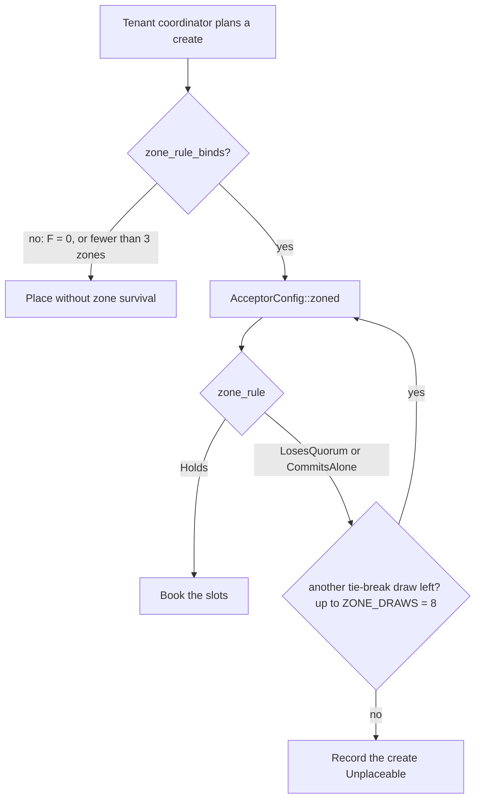

# Zone rule

Group: Quorums. Status: verified 2026-10-31.

A cell spans several availability zones. A journal survives the loss of a zone only if its
acceptors are spread so that the members outside any one zone still hold both quorums. The **zone
rule** is two predicates over a configuration's members and their failure domains, each asked
through the configuration's own quorum predicates, never a count (#215 (zones)):

1. **It survives any one failure domain**: for every domain, the members outside it still hold a
   Phase-1 quorum and a Phase-2 quorum.
2. **No domain commits alone**: for every domain, the members inside it hold no Phase-2 quorum.

## 1. Problem

A quorum system counts acceptors. A zone takes several acceptors down at once. A majority of
five placed 3/1/1 loses its majority with the zone that holds three. A Phase-2 quorum that sits in
one zone decides a value that the loss of that zone can make unreadable for a while, and every
later Phase 1 must wait for that zone. The placement must know the zones, and the rule must hold
for every quorum system the cell runs.

## 2. Model

- Crash failures of single acceptors, and **correlated** failures of every acceptor in one zone
  ([WPaxos §3.1]: `fz` zone failures and `fn` node failures per zone).
- A failure domain is `FailureDomain { region, az }`: two short labels, compared for equality
  only. The core never parses or orders them (`membership/failure_domain.rs`).
- One region per cell until multi-region cells (#253): `region` stays empty.

## 3. Roles and state

| What | Where | Durable? |
|---|---|---|
| Each member's failure domain | a vector parallel to the sorted members of `AcceptorConfig` (`AcceptorConfig::zoned`, `domains`) | yes, bound to the ballot with the configuration |
| The rule's verdict | `ZoneRule`: `Unlabeled`, `Holds`, `LosesQuorum(d)`, `CommitsAlone(d)` | derived |
| Where the rule binds | `paros::model::placement::zone_rule_binds` | derived from the registry |

The labels are copied from the registry's zone tag when a configuration is composed, never read
live by a tally. Two nodes that disagreed on a label would evaluate different quorums, so the
labels are bound to the ballot like the members (`docs/architecture/05-failure-model-and-zones.md`
§5). An empty vector is the plain arm: an unlabeled configuration is byte-identical on the wire to
the one before #215 (the store format still moved to version 5).

## 4. Normal flow

The rule is asked when a create is placed, not on the data path. A move labels the members that
stay, but the rule on a move's replacement is not yet built (05 §5).

`AcceptorConfig::zone_rule` checks, for each distinct domain `d`:

1. `has_phase1_quorum(outside d)` and `has_phase2_quorum(outside d)`, else `LosesQuorum(d)`;
2. `!has_phase2_quorum(inside d)`, else `CommitsAlone(d)`.

Under a majority, 1/1/1 and 2/2/1 hold; 3/1/1 and 2/1/1 lose a quorum with zone `a`; any spread
over two zones loses one (`membership/zone_rule/tests.rs`).

## 5. Recovery flow

- **A zone is lost.** The journal keeps a Phase-1 and a Phase-2 quorum outside it, so it keeps
  electing and deciding. The tenant coordinator waits out the re-placement bound, then replaces
  the lost acceptors by reconfiguration.
- **The degraded trap.** A `machines=2` journal placed 2/2/1 that loses a zone of two keeps three
  of five, with no slack, and the rule cannot be met again over two zones. The journal shows
  `Degraded`. The design re-places it only into a fourth zone, never into two
  (`docs/architecture/05-failure-model-and-zones.md` §5); the rule on a move's replacement is not
  yet built.
- **Partitions.** A zone loss strikes every column at once; after it each column has spent its
  margin, and one more failure in any column stops elections.

## 6. Why it is safe

The rule is about availability, not safety: Paxos safety never depends on where acceptors sit.
Its value is that it is asked **through the quorum predicates**, so it is correct for every
quorum system without a special case:

- under a majority or a flexible split, `has_phase1_quorum` and `has_phase2_quorum` count;
- under a grid they ask per column, so the rule applies **per partition** without code of its own
  (the `ZoneRule` doc).

[WPaxos §3.1] builds zone survival into the quorum system itself: `q1` spans `Z − fz` zones and
`q2` spans `fz + 1` zones, so the two share a zone, and inside it `fn + 1` and `l − fn` nodes
overlap (Lemma 1). The zone rule keeps paros's quorum systems and checks the same two facts on a
placed configuration: predicate 1 is "a `q1` and a `q2` exist outside any one zone"; predicate 2
is "every `q2` spans at least two zones", WPaxos's `fz = 1`.

## 7. Liveness

- A placed journal over three zones or more survives any one zone (predicate 1).
- No zone holds a Phase-2 quorum alone (predicate 2), so a zone that is cut off cannot decide
  values the other zones then cannot learn.
- Over one or two zones no configuration meets both predicates; the rule does not bind there,
  and the journal is placed without zone survival (`zone_rule_binds`).

## 8. Costs

- Every Phase 2 spans two zones, so a write pays an inter-zone round trip. That is the price of
  zone survival; WPaxos's latency win exists only at `fz = 0`, which gives it up (05 §5).
- A few dozen bytes per member in a configuration of at most nine members, for the labels.
- A plan can be `Unplaceable`: a four-member majority over three zones (2/1/1) never holds.

## 9. In paros

| What | Where |
|---|---|
| The rule | `paros-core/src/membership/zone_rule.rs`: `ZoneRule`, `AcceptorConfig::zone_rule`, `distinct_domains` |
| The labels | `paros-core/src/membership/failure_domain.rs`: `FailureDomain`, `MAX_FAILURE_DOMAIN_BYTES`; `AcceptorConfig::zoned`, `domains`, `domain_of`, `is_zoned` |
| Where it binds, and the redraws | `paros-model/src/placement.rs`: `zone_rule_binds`, `ZONE_DRAWS` |
| The decision | `docs/architecture/05-failure-model-and-zones.md` §5 (#215, #748 (survive)) |

**Sim gates and oracles:**

- `"zones: a configuration's labels are bound to its ballot"` (`paros-sim/src/audit/state.rs`).
- `"zones: a placed journal that spans three zones survives any one"` and the gate `"zones: a
  journal is placed over three zones"` (`audit/tenants.rs`).
- The composer, on a third of the seeds (`shape::acceptor_zones`, `"zones: a run labels its
  acceptor pool"`), sends labeled configurations, each judged by the rule: `"zones: the composer
  proposes a configuration that holds the zone rule"` and `"… that breaks the zone rule"`
  (`workload/reconfigure.rs`).
- The zone-outage scenario (`paros-sim/src/world/scenarios/zone_outage.rs`, drawn by
  `shape::zone_outage` with `"zones: a run draws the zone-outage scenario"`): every machine of
  one zone crashes for 10 to 16 s (6 to 10 s in the recovery tail), and `"zones: a created journal commits an append with a zone
  down"` (`workload/fleet/journals.rs`; in `gates::RARE`, a marginal gate).

**Divergences from the sources:**

- WPaxos's per-zone quorum system is **not adopted** (decided on 2026-10-07, #215): with
  `fz = 1` every Phase 2 spans two zones, exactly like a zone-balanced majority, while it
  tolerates fewer node failures than that majority.
- paros's grid cannot express zone survival: rows and columns are positional over sorted ids,
  so with column = zone a zone loss kills every row, and with row = zone every column.
- [WPaxos §3.1]'s printed TLA⁺ quorum definition does not intersect; only the "floor form" its
  proof uses is sound (a counterexample on the paper's own Figure 3b grid is in the transcript).
  The zone rule avoids the question: it never defines quorums, it only asks the configuration's.

## 10. Pitfalls

- **A count where a predicate belongs.** "At least two zones in every Phase-2 quorum" as a
  count would be wrong under a flexible split or a grid. The rule asks `has_phase2_quorum` on
  the members of each domain instead.
- **Cell-scoped zone ids.** A pair of integers would let one cell's `az 2` equal another's, so a
  move between cells could accept a placement that does not survive a zone. Names are
  universe-wide strings (05 §5).
- **A column in one zone.** It commits alone, and after its loss it blocks every later
  reconfiguration, because Phase 1 needs a majority of every old column (05 §5).

## 11. Relatives

- [Flexible quorums](flexible-quorums.md) and [grid quorums](grid-quorums.md): the predicates
  the rule asks.
- [Leader handoff](leader-handoff.md): the leader that follows its writer's zone (#581, not yet
  built).
- Reconfiguration cards (planned): how a lost zone's acceptors are replaced.

## 12. Sources

- [WPaxos] Ailijiang, Charapko, Demirbas, Kosar, *WPaxos: Wide Area Network Flexible Consensus*:
  `docs/references/papers/wpaxos/transcript.md` §3.1 (`fz`, `fn`, Lemma 1, `Fmin`/`Fmax`, the
  printed definition and its counterexample), §5.3 (fault tolerance: one zone and a minority per
  zone by default).
- [FPaxos] *Flexible Paxos*: `docs/references/papers/flexible-paxos/transcript.md` §3 (the
  intersection both predicates rely on).
- AWS cell-based architecture: `docs/references/papers/aws-cell-based-architecture/` (cells and
  zones as failure domains).

[WPaxos §3.1]: ../../references/papers/wpaxos/transcript.md
